# Hotel Management System — Low-Level Design

| Field | Value |
|---|---|
| Document title | Hotel Management System Low-Level Design |
| Version | 1.0 |
| Status | Implemented baseline |
| Date | 2026-10-27 |
| Audience | Backend engineers, reviewers, operators, QA |
| Scope | Implemented backend, local deployment, data design, security, testing, operations |
| Source of truth | This repository at `/Users/shashimani/Codes/hmNext` |

> Length note: this document is intentionally detailed. At typical A4/Letter rendering it is approximately 30+ pages including tables and 15 diagrams. Diagrams use Mermaid and render on GitHub, GitLab, VS Code, and compatible Markdown viewers.

## Table of Contents

1. [Purpose and Scope](#1-purpose-and-scope)
2. [Executive Summary](#2-executive-summary)
3. [Requirements](#3-requirements)
4. [Architecture Overview](#4-architecture-overview)
5. [Use Cases](#5-use-cases)
6. [Component Design](#6-component-design)
7. [Class and Domain Design](#7-class-and-domain-design)
8. [Data Design](#8-data-design)
9. [API Design](#9-api-design)
10. [Workflows and Sequences](#10-workflows-and-sequences)
11. [Transactions, Consistency, and Failure Handling](#11-transactions-consistency-and-failure-handling)
12. [Security Design](#12-security-design)
13. [Non-Functional Design](#13-non-functional-design)
14. [Testing Strategy](#14-testing-strategy)
15. [Deployment and Operations](#15-deployment-and-operations)
16. [Risks, Limitations, and Future Work](#16-risks-limitations-and-future-work)
17. [Traceability Matrix](#17-traceability-matrix)
18. [Glossary](#18-glossary)
- [Appendix A — Public API Summary](#appendix-a--public-api-summary)
- [Appendix B — Internal API Summary](#appendix-b--internal-api-summary)
- [Appendix C — Configuration Reference](#appendix-c--configuration-reference)
- [Appendix D — Design Decisions](#appendix-d--design-decisions)

---

## 1. Purpose and Scope

### 1.1 Purpose

This document describes the low-level design of the implemented Hotel Management backend. It explains how the system is decomposed, how each service is structured, how data is stored, how requests flow, how consistency is maintained across service boundaries, and how the system is secured, tested, run, and operated.

It is written to be sufficient for:

- A new engineer to understand and modify the system.
- A reviewer to assess correctness, security, and design trade-offs.
- A QA engineer to derive test scenarios.
- An operator to run the local topology and understand failure modes.
- A future architect to plan production hardening.

### 1.2 Scope

In scope:

- Four business services: Auth, Rooms, Guests, Reservations.
- One API gateway.
- Two shared projects: SharedKernel and SharedInfrastructure.
- SQL Server persistence with EF Core.
- JWT authentication and role-based authorization.
- Internal service-to-service HTTP calls with a shared API key.
- Reservation lifecycle: create, reschedule, cancel, no-show, check-in, check-out.
- Room inventory: room types, rooms, availability blocks, occupancy.
- Guest profiles and active/inactive lifecycle.
- Automated unit, integration, and gateway tests.
- Local manual deployment and operations.

### 1.3 Out of Scope

The implemented backend does not include:

- A frontend application, mobile app, or staff portal.
- Payment processing, deposits, invoices, refunds, or taxes.
- Housekeeping, maintenance ticketing, or work orders.
- Night audit, reporting, analytics, or revenue management.
- Pricing engines, rate plans, seasonal pricing, or channel managers.
- Multi-property or multi-tenant behavior.
- Notifications (email, SMS, push).
- Document/image storage for identity documents.
- Refresh tokens, logout, password reset, or self-service account management.
- Production cloud infrastructure, infrastructure as code, or Kubernetes manifests.
- Message broker, outbox, event sourcing, or asynchronous messaging.

### 1.4 Definitions

| Term | Meaning |
|---|---|
| Availability block | A room hold for a half-open date interval `[StartDate, EndDate)` owned by the Rooms service |
| Hold | The act of creating an availability block for a reservation |
| Release | Deleting an availability block |
| Occupancy | The current operational room status `Occupied`, distinct from future date availability |
| Snapshot | A copy of guest/room data stored in a reservation for historical stability |
| Public endpoint | `/api/*` route reachable through the gateway and protected by JWT/RBAC |
| Internal endpoint | `/internal/*` route not exposed by the gateway, protected by an internal API key |
| Operational room | A room whose status is not `Maintenance` or `OutOfService` |
| Half-open interval | A date range that includes the start date and excludes the end date |
| Compensation | A best-effort reverse action when a later step in a distributed workflow fails |
| Test database | A unique `Hotel<Service>Tests_<Guid>` database created and deleted by integration tests |

### 1.5 References

- Root setup and manual test guide: `README.md`
- API reference: `docs/API.md`
- Testing guide: `docs/TESTING.md`
- Solution: `HotelManagement.sln`
- Gateway routes: `src/Gateway/HotelManagement.Gateway.Api/ocelot.json`
- Environment template: `.env.example`

---

## 2. Executive Summary

The system is a backend-only hotel management platform implemented as four independently deployable ASP.NET Core services behind an Ocelot API gateway. Each service owns its own SQL Server database and follows a four-layer Clean Architecture structure: Domain, Application, Infrastructure, and Api.

The design prioritizes:

- **Clear ownership.** Auth owns identity and roles. Rooms owns inventory and date availability. Guests owns guest profiles. Reservations owns reservation lifecycle and historical snapshots.
- **Explicit service boundaries.** Cross-service reads and writes happen through typed HTTP clients and private internal endpoints, not shared databases.
- **Immediate inventory correctness.** Creating or moving a reservation hold uses a serializable transaction in Rooms, preventing overlapping holds for the same room.
- **Practical distributed consistency.** There is no distributed transaction. The system uses a hold-first workflow with best-effort compensation and logs compensation failures.
- **Strong authorization.** JWT bearer authentication is validated by every service. Owner, Manager, and Receptionist roles map to explicit policies. Internal routes require a separate shared key and are not exposed through the gateway.
- **Historical stability.** Reservations snapshot guest and room fields so later guest or room edits do not rewrite history.
- **Testability.** Integration tests use real SQL Server databases with unique names per factory and do not touch local development databases.

The current deployment model is a local developer topology: a SQL Server container, four service processes, and one gateway process. The backend is intentionally not Dockerized as a full stack; only SQL Server is expected to run in a container for local development.

The most important known limitations are the absence of an outbox/message broker, static internal-key rotation, no JWT revocation before expiry, no idempotency key for reservation creation, and no production-grade observability or rate limiting. These are described in Section 16.

---

## 3. Requirements

### 3.1 Functional Requirements

| ID | Requirement | Owner |
|---|---|---|
| FR-01 | Users can sign in with email and password and receive a JWT | Auth |
| FR-02 | An authenticated user can read their own identity and roles | Auth |
| FR-03 | Owners can list, create, read, activate, deactivate users and replace roles | Auth |
| FR-04 | The system prevents removal or deactivation of the last active Owner | Auth |
| FR-05 | Owners, Managers, and Receptionists are authorized by policy | Auth + all services |
| FR-06 | Managers and Owners can manage room types and rooms | Rooms |
| FR-07 | Receptionists can read inventory and change room status | Rooms |
| FR-08 | The system can list rooms available for a date range | Rooms |
| FR-09 | The system can create, move, and release availability blocks | Rooms |
| FR-10 | The system prevents overlapping availability blocks for one room | Rooms |
| FR-11 | The system can mark a room occupied or available | Rooms |
| FR-12 | Managers and Owners can manage and deactivate guests | Guests |
| FR-13 | Receptionists can read guest profiles | Guests |
| FR-14 | Staff can create a reservation for an active guest and operational room | Reservations |
| FR-15 | A reservation records guest/room snapshots, nightly rate, nights, and total | Reservations |
| FR-16 | Staff can reschedule a confirmed reservation without changing room or rate | Reservations |
| FR-17 | Staff can cancel or mark a confirmed reservation no-show and release the hold | Reservations |
| FR-18 | Staff can check in a confirmed reservation and occupy the room | Reservations |
| FR-19 | Staff can check out a checked-in reservation, release the hold, and make the room available | Reservations |
| FR-20 | The gateway exposes public routes and aggregates Swagger documents | Gateway |
| FR-21 | Internal routes are inaccessible through the gateway and require an internal key | Rooms, Guests |
| FR-22 | The system exposes database-backed health checks | All services |
| FR-23 | The system applies EF Core migrations and seeds roles/Owner at startup | Auth, Rooms, Guests, Reservations |
| FR-24 | The system returns RFC 7807-style problem details and echoes a correlation ID | All services |

### 3.2 Non-Functional Requirements

| ID | Requirement | Design response |
|---|---|---|
| NFR-01 | Service data must be isolated | One database per service; no cross-database foreign keys |
| NFR-02 | Public endpoints must require authentication and role authorization | JWT validation and policies in every service |
| NFR-03 | Internal endpoints must not be publicly reachable | No gateway route; `X-Internal-Api-Key` middleware |
| NFR-04 | Invalid input must fail consistently | FluentValidation, domain guards, DB check constraints |
| NFR-05 | Concurrent overlapping holds must not both succeed | Serializable transaction + overlap query |
| NFR-06 | Reservation history must remain stable after guest/room edits | Snapshot fields |
| NFR-07 | The system must be testable without damaging local data | Unique test databases per integration factory |
| NFR-08 | The system must expose operational liveness/readiness signals | `/health` with DbContext check |
| NFR-09 | The system must support diagnostic correlation | `X-Correlation-ID` middleware and error extensions |
| NFR-10 | The codebase must be maintainable and layered | Clean Architecture projects and dependency rules |
| NFR-11 | The local stack must be runnable manually | Documented `dotnet run` topology and SQL container |
| NFR-12 | The system must not claim unsupported production guarantees | Risks and limitations are documented explicitly |

### 3.3 Assumptions

- One hotel property is served by one deployment.
- One implicit currency is used for all monetary amounts.
- Amounts are stored as `decimal` and rounded to two decimal places.
- Dates are calendar dates without time zones. Timestamps are UTC.
- A reservation belongs to exactly one room for its entire lifetime.
- A reservation has at most one availability block.
- A room availability block represents a reservation hold, not a maintenance block.
- A guest can have many reservations.
- A room can have many reservations and blocks over time.
- The local developer machine can run SQL Server in Docker and five .NET processes.

### 3.4 Constraints

- .NET 10 and EF Core 10.
- SQL Server is the only supported database provider.
- The gateway routes to fixed localhost ports in `ocelot.json`.
- Services validate JWT independently; the gateway is not an authorization boundary.
- Internal communication is synchronous HTTP.
- There is no message broker or background worker.
- Local configuration is supplied through environment variables, not a secret manager.
- Integration tests require a SQL login with database create/drop permission.

---

## 4. Architecture Overview

### 4.1 Architecture Style

The system uses a pragmatic microservice architecture with database-per-service, synchronous HTTP integration, and a gateway for public entry. Each service applies Clean Architecture dependency rules.

Key principles:

1. **Domain first.** Business invariants live in domain entities and value objects, not controllers.
2. **Application orchestration.** Application services coordinate repositories, validators, HTTP directories, logging, and time.
3. **Infrastructure at the edge.** EF Core, Identity, HTTP clients, JWT creation, and persistence live in Infrastructure.
4. **Thin API layer.** Controllers bind requests, enforce policies, delegate, and return HTTP results.
5. **Explicit contracts.** DTO records define API boundaries; entities are not serialized directly.
6. **No shared database.** A service reads another service only through its API.
7. **Fail visibly.** Domain/application exceptions map to problem details; unexpected errors become `500`.
8. **Compensate, do not pretend.** Distributed workflows acknowledge the possibility of partial failure.

### 4.2 System Context Diagram

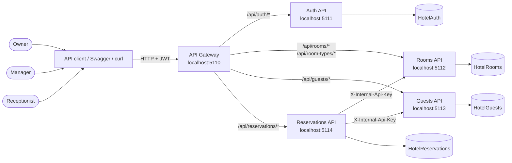

The gateway is a routing and Swagger aggregation layer. It does not issue tokens, validate roles, or enforce business rules. Each downstream service validates the JWT and enforces its own policies.

### 4.3 Container and Deployment View

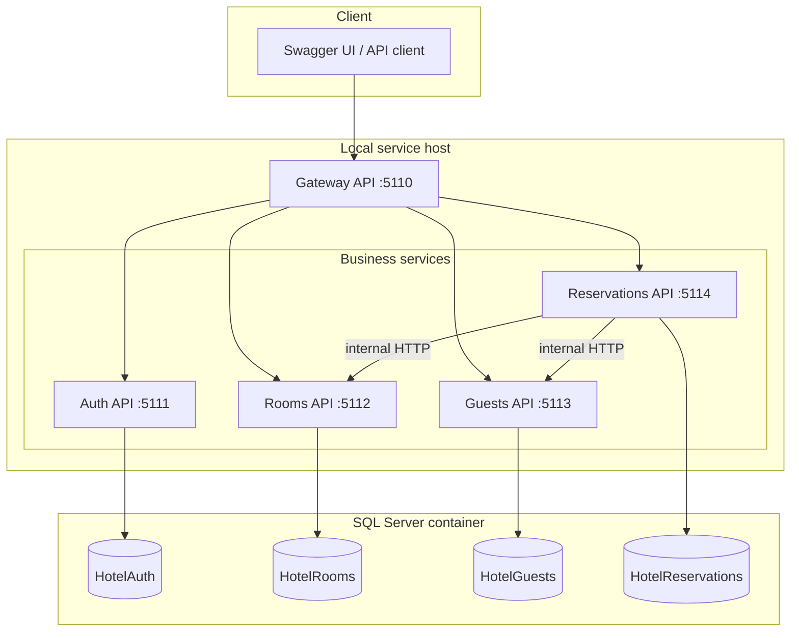

The local SQL Server container is named `hmnext-sql` and normally maps host port `1434` to container port `1433`. The services run as separate `dotnet run` processes. There are no service Dockerfiles in this repository.

### 4.4 Service Responsibilities

| Service | Owns | Does not own | Primary dependencies |
|---|---|---|---|
| Auth | Users, password hashes, roles, role assignments, JWT issuance | Guest profiles, room inventory, reservations | SQL Server, Identity |
| Rooms | Room types, rooms, room status, availability blocks | Guest identity, reservation lifecycle | SQL Server |
| Guests | Guest profiles, active flag, identity document fields | Reservations, room inventory | SQL Server |
| Reservations | Reservation lifecycle, snapshots, totals, dates | Guest master data, room master data, date holds | SQL Server, Rooms, Guests |
| Gateway | Routing, Swagger aggregation | Authentication decisions, domain data | All public services |

### 4.5 Request Paths

There are three request paths:

1. **Public gateway path.** Client → Gateway → owning service → service database. Used by staff clients.
2. **Public direct path.** Client → service → service database. Used for local diagnostics and service Swagger.
3. **Internal path.** Reservations → Rooms or Guests using `/internal/*` and `X-Internal-Api-Key`. Used for reservation orchestration.

Public paths use JWT. Internal paths use the internal key and deliberately bypass JWT because the caller is a trusted service, not an end user.

### 4.6 Why Database per Service

Database-per-service was chosen to:

- Keep ownership unambiguous.
- Prevent accidental cross-service joins that couple schemas.
- Allow independent migrations and future independent scaling.
- Force explicit contracts through HTTP.
- Allow the reservation service to snapshot data rather than depend on live joins.

The cost is that consistency is eventual and cross-service queries are not transactional. The design addresses the most important case—room date contention—with a serializable hold in Rooms.

### 4.7 Why Synchronous HTTP

Synchronous HTTP was chosen because:

- Reservation creation needs an immediate availability decision.
- The expected local/team scale does not justify broker operations.
- Failures must be visible to the caller as `503` rather than silently queued.
- The system is small enough that typed `HttpClient` calls are understandable.

The cost is temporal coupling: a reservation cannot be created if Rooms or Guests is unavailable.

---

## 5. Use Cases

### 5.1 Actors

| Actor | Description |
|---|---|
| Owner | Full administrator; manages users, roles, inventory, guests, and reservations |
| Manager | Manages inventory and guests; performs operational reservation work |
| Receptionist | Reads inventory and guests; changes room status; performs reservation work |
| Reservations service | System actor that calls Rooms and Guests internal endpoints |
| Operator | Runs health checks, migrations, and local processes |

### 5.2 Use Case Diagram

```mermaid
flowchart LR
    Owner([Owner])
    Manager([Manager])
    Receptionist([Receptionist])
    ResSvc[[Reservations service]]
    Operator([Operator])

    subgraph HMS[Hotel Management Backend]
        UC01((Sign in))
        UC02((Manage users and roles))
        UC03((Manage room types))
        UC04((Manage rooms))
        UC05((Change room status))
        UC06((Manage guests))
        UC07((Read guests))
        UC08((Create reservation))
        UC09((Reschedule reservation))
        UC10((Cancel or no-show))
        UC11((Check in))
        UC12((Check out))
        UC13((Hold availability))
        UC14((Move availability block))
        UC15((Release availability block))
        UC16((Set room occupancy))
        UC17((Health and Swagger))
    end

    Owner --> UC01
    Owner --> UC02
    Owner --> UC03
    Owner --> UC04
    Owner --> UC05
    Owner --> UC06
    Owner --> UC07
    Owner --> UC08
    Owner --> UC09
    Owner --> UC10
    Owner --> UC11
    Owner --> UC12

    Manager --> UC01
    Manager --> UC03
    Manager --> UC04
    Manager --> UC05
    Manager --> UC06
    Manager --> UC07
    Manager --> UC08
    Manager --> UC09
    Manager --> UC10
    Manager --> UC11
    Manager --> UC12

    Receptionist --> UC01
    Receptionist --> UC05
    Receptionist --> UC07
    Receptionist --> UC08
    Receptionist --> UC09
    Receptionist --> UC10
    Receptionist --> UC11
    Receptionist --> UC12

    ResSvc --> UC13
    ResSvc --> UC14
    ResSvc --> UC15
    ResSvc --> UC16
    Operator --> UC17
```

### 5.3 Use Case Catalog

| ID | Use case | Primary actor | Preconditions | Postconditions |
|---|---|---|---|---|
| UC-01 | Sign in | Staff | Active user exists | JWT returned; failed count reset on success |
| UC-02 | Manage users and roles | Owner | Owner token | User/roles changed; last-owner safeguards hold |
| UC-03 | Manage room types | Owner/Manager | Authenticated | Room type created/updated |
| UC-04 | Manage rooms | Owner/Manager | Room type exists | Room created/updated |
| UC-05 | Change room status | All staff | Room exists | Status changed within enum |
| UC-06 | Manage guests | Owner/Manager | Authenticated | Guest created/updated/deactivated |
| UC-07 | Read guests | All staff | Authenticated | Guest data returned |
| UC-08 | Create reservation | All staff | Active guest, operational room | Reservation `Confirmed`, block held |
| UC-09 | Reschedule reservation | All staff | Reservation `Confirmed` | Dates, nights, total updated; block moved |
| UC-10 | Cancel/no-show | All staff | Reservation `Confirmed` | Terminal status; hold released |
| UC-11 | Check in | All staff | Reservation `Confirmed` | `CheckedIn`; room `Occupied` |
| UC-12 | Check out | All staff | Reservation `CheckedIn` | `CheckedOut`; room `Available`; hold released |
| UC-13 | Hold availability | Reservations service | Operational room, valid dates | Block created |
| UC-14 | Move availability block | Reservations service | Block exists | Dates changed atomically |
| UC-15 | Release availability block | Reservations service | Block exists | Block deleted |
| UC-16 | Set room occupancy | Reservations service | Room exists | Status `Occupied`/`Available` |
| UC-17 | Health and Swagger | Operator | Service running | Diagnostics available |

### 5.4 Detailed Use Cases

#### UC-08 Create Reservation

**Preconditions**

- Caller has a valid JWT with `Operations` policy access.
- Guest exists and is active.
- Room exists and is operational.
- Requested dates are valid and the room capacity is sufficient.

**Main flow**

1. Reservations validates the request.
2. Reservations calls `GET /internal/guests/{id}`.
3. Reservations calls `GET /internal/rooms/{id}`.
4. Reservations builds a reservation with guest/room snapshots and calculated total.
5. Reservations calls `POST /internal/rooms/{roomId}/availability-blocks`.
6. Rooms validates dates, operational status, and overlap inside a serializable transaction.
7. Rooms creates the block and returns its ID.
8. Reservations assigns the block ID and saves the reservation.
9. Reservations returns `201 Created`.

**Alternative flows**

- Guest missing → `404`.
- Guest inactive → `409`.
- Room missing → `404`.
- Room non-operational or too small → `409`.
- Hold conflict → `409`.
- Rooms/Guests down or timed out → `503`.
- Local save fails after hold → Reservations attempts to release the block and rethrows.

#### UC-09 Reschedule Reservation

**Preconditions**

- Reservation exists.
- Reservation status is `Confirmed`.
- Reservation has an availability block.

**Main flow**

1. Validate new dates.
2. Fetch reservation.
3. Reject non-confirmed status.
4. Preserve original stay and send the block move to Rooms.
5. Rooms updates the block inside a serializable transaction, excluding itself from overlap checks.
6. Reservation recalculates nights and total at the existing nightly rate.
7. Local save succeeds.
8. Return `200`.

**Alternative flows**

- New dates overlap another block → `409`; original block remains unchanged.
- Local save fails after block move → attempt to move the block back; log if compensation fails.
- Rooms unavailable → `503`.

#### UC-11 Check In

**Preconditions**

- Reservation exists and is `Confirmed`, or already `CheckedIn` for retry.
- Room exists.

**Main flow**

1. Fetch reservation.
2. If already `CheckedIn`, reassert occupancy and return success.
3. Mark reservation `CheckedIn`.
4. Call Rooms occupancy endpoint with `occupied=true`.
5. Save reservation.
6. Return `200`.

**Alternative flows**

- Room cannot be occupied from its status → `409`.
- Local save fails after occupancy → attempt to release occupancy; log if compensation fails.

#### UC-12 Check Out

**Preconditions**

- Reservation exists and is `CheckedIn`, or already `CheckedOut` for retry.

**Main flow**

1. Fetch reservation.
2. If not already `CheckedOut`, mark and save.
3. Release the availability block.
4. Set room occupancy to available.
5. Return `200`.

**Alternative flows**

- Downstream failure → return `503`; the reservation may already be `CheckedOut`. A retry repeats downstream synchronization.

#### UC-10 Cancel / No-Show

**Preconditions**

- Reservation is `Confirmed`.

**Main flow**

1. Validate request (cancel reason at most 500 characters).
2. Release the availability block.
3. Mark `Cancelled` or `NoShow`.
4. Save.
5. Return `200`.

**Alternative flows**

- Non-confirmed reservation → `400`.
- Downstream release failure → `503`.
- Local save failure after release → the hold is gone while the reservation remains confirmed. This is a known limitation.

---

## 6. Component Design

### 6.1 Layer Model

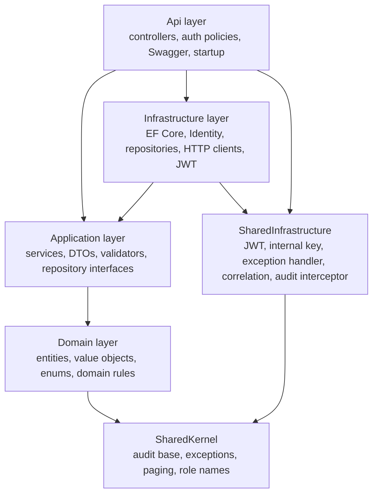

Dependency rules:

- Domain references only SharedKernel.
- Application references Domain and SharedKernel; it does not reference EF Core or ASP.NET.
- Infrastructure references Application, SharedInfrastructure, and EF Core.
- Api references Application, Infrastructure, and SharedInfrastructure.
- SharedKernel has no project dependencies.
- SharedInfrastructure references SharedKernel and ASP.NET Core abstractions.

### 6.2 SharedKernel

| Type | Responsibility |
|---|---|
| `AuditableEntity` | GUID identity plus created/updated timestamps and user IDs |
| `IAuditable` | Audit contract used by the EF interceptor |
| `PagedResult<T>` | Common paging shape with computed total pages |
| `RoleNames` | Canonical `Owner`, `Manager`, `Receptionist` names |
| `DomainException` | Business-rule violation mapped to `400` |
| `AppValidationException` | Structured validation failure mapped to `400` |
| `NotFoundException` | Missing resource mapped to `404` |
| `ConflictException` | State/duplicate conflict mapped to `409` |
| `UnauthorizedException` | Authentication failure mapped to `401` |
| `ForbiddenException` | Authorization failure mapped to `403` |
| `DownstreamServiceException` | Downstream dependency failure mapped to `503` |

`AuditableEntity` generates a new GUID at construction. The audit interceptor overwrites `CreatedAtUtc` only when it is still `default`; this allows tests or import paths to supply a timestamp. Modified entities receive `UpdatedAtUtc`/`UpdatedBy`; created fields are marked unmodified so they cannot be accidentally rewritten.

### 6.3 SharedInfrastructure

| Component | Responsibility |
|---|---|
| `AddSharedInfrastructure` | Registers HTTP context access, current user, time provider, audit interceptor, problem details, exception handler |
| `JwtAuthenticationExtensions` | Binds and validates JWT options, configures bearer validation, registers policies |
| `JwtOptions` | Issuer, audience, signing key, expiry minutes |
| `CorrelationIdMiddleware` | Reads or creates `X-Correlation-ID`, sets trace identifier, response header, logging scope |
| `GlobalExceptionHandler` | Maps exceptions to RFC 7807 problem details and logs at warning/error |
| `InternalApiKeyExtensions` | Registers key options, validates key length, enforces `/internal` key check |
| `AuditableEntityInterceptor` | Applies audit fields on EF save |
| `HttpContextCurrentUser` | Resolves user ID, email, name, roles from JWT claims |
| `AuthorizationPolicies` | Canonical policy names |

#### 6.3.1 Correlation ID

`CorrelationIdMiddleware` runs before exception handling. It accepts `X-Correlation-ID`; if absent it uses `Activity.Current?.Id` or `HttpContext.TraceIdentifier`. It sets:

- `HttpContext.TraceIdentifier`
- `HttpContext.Items["CorrelationId"]`
- Response header `X-Correlation-ID`
- Logger scope property `CorrelationId`

The exception handler copies the correlation ID into `ProblemDetails.Extensions["correlationId"]` and uses the trace identifier as `traceId`.

#### 6.3.2 Exception Mapping

| Exception | Status | Title |
|---|---:|---|
| `ValidationException` | 400 | Validation failed |
| `AppValidationException` | 400 | Validation failed |
| `DomainException` | 400 | Business rule violation |
| `UnauthorizedException` | 401 | Unauthorized |
| `ForbiddenException` | 403 | Forbidden |
| `NotFoundException` | 404 | Resource not found |
| `ConflictException` | 409 | Conflict |
| `DownstreamServiceException` | 503 | Service unavailable |
| Other | 500 | Internal server error |

Validation errors are grouped by property name. Unexpected exceptions are logged with the exception; client responses do not expose stack traces.

### 6.4 Auth Service

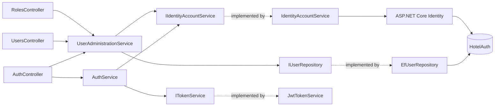

Responsibilities:

- Validate credentials through `UserManager`.
- Reject inactive and locked-out users.
- Generate HMAC-SHA256 JWTs with subject, email, name, JTI, issued-at, expiry, and role claims.
- Expose `/api/auth/me` for the current principal.
- Administer users and roles under `OwnerOnly`.
- Seed canonical roles and a bootstrap Owner at startup.
- Enforce last-active-Owner safeguards.

Auth uses `IdentityDbContext<ApplicationUser, ApplicationRole, Guid>`. `ApplicationUser` extends `IdentityUser<Guid>` and implements `IAuditable`. The audit interceptor applies to user creation and updates.

Bootstrap sequence:

1. Apply migrations.
2. Ensure `Owner`, `Manager`, `Receptionist` roles exist.
3. If `Bootstrap:OwnerEmail` and `Bootstrap:OwnerPassword` are configured:
   - Create a normalized-email user if absent.
   - Assign `Owner`.
   - If present but inactive, reactivate.
   - If present but not Owner, add Owner.
4. Log creation/readiness, or a warning if bootstrap is unconfigured.

### 6.5 Rooms Service

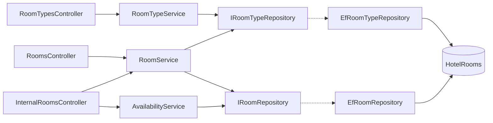

Responsibilities:

- Manage room types, rooms, notes, and status.
- Compute availability from status and block overlap.
- Create blocks under serializable isolation.
- Move blocks without releasing them first.
- Release blocks.
- Enforce internal-key protection on `/internal/*`.
- Hide internal routes from Swagger.

Room status semantics:

| Status | Bookable? | Check-in target? | Notes |
|---|---|---:|---|
| `Available` | Yes, if no block overlap | Yes | Default |
| `Occupied` | Yes for future dates with no block overlap | No-op reassert only | Current occupancy is not a calendar block |
| `Maintenance` | No | No | Non-operational |
| `OutOfService` | No | No | Non-operational |

Important nuance: `GET /api/rooms/available` excludes only `Maintenance` and `OutOfService`. An `Occupied` room with no block for the requested future dates can appear available for those future dates. This is intentional: current occupancy is not a future calendar block. Check-in uses the occupancy endpoint, which only allows `Available` or already `Occupied`.

### 6.6 Guests Service

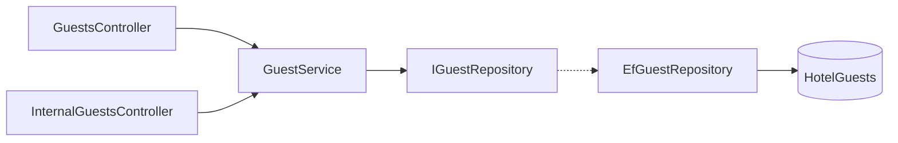

Responsibilities:

- Normalize names, email, phone, and optional text.
- Enforce unique email case-insensitively.
- Validate date of birth bounds.
- Enforce document type/number pairing.
- Activate/deactivate guests.
- Return a compact internal summary for Reservations.

Guests are never hard-deleted. Deactivation prevents new reservations; it does not modify existing reservation snapshots.

### 6.7 Reservations Service

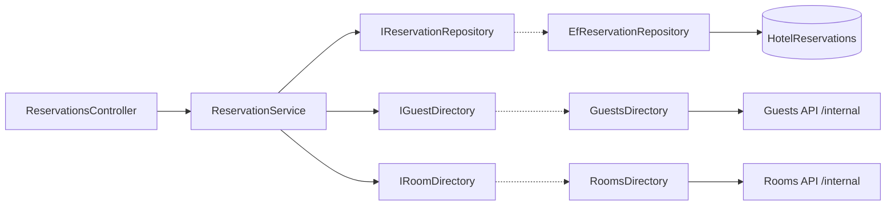

Responsibilities:

- Orchestrate guest and room lookups.
- Snapshot guest and room data.
- Calculate nights and total.
- Hold availability before persisting.
- Reschedule with block move and compensation.
- Cancel/no-show with block release.
- Check-in with occupancy synchronization.
- Check-out with status save, block release, and occupancy release.
- Map downstream failures to `503` and log compensation failures.

The typed `HttpClient` registrations use a 15-second default timeout, the internal key header, and base URLs from `Services:RoomsBaseUrl` and `Services:GuestsBaseUrl`.

### 6.8 Gateway

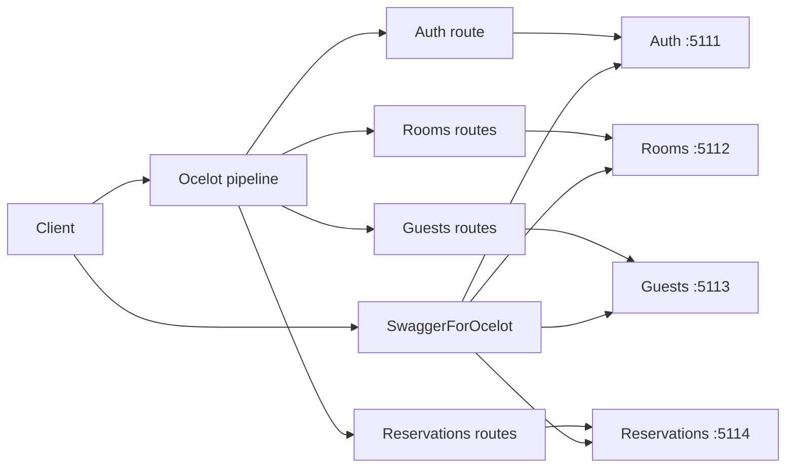

Responsibilities:

- Load `ocelot.json` (or `OCELOT_CONFIG_PATH`).
- Route public paths only.
- Expose `/health`.
- Serve aggregated Swagger UI and documents in Development.
- Do not validate JWT or roles.
- Do not route `/internal/*`.

Route keys include both exact collection paths and `{everything}` catch-alls. This supports collection endpoints and item/action endpoints with the same upstream prefix.

### 6.9 Component Interaction Rules

| From | To | Allowed? | Mechanism |
|---|---|---|---|
| Api | Application | Yes | DI |
| Api | Infrastructure | Yes | DI registration/startup |
| Application | Domain | Yes | Direct |
| Application | Another service | No direct DB; yes via interface | `IGuestDirectory`, `IRoomDirectory` |
| Infrastructure | Application abstractions | Yes | Implementations |
| Rooms/Guests | Reservations | No | No reverse dependency |
| Any service | Another service database | No | Prohibited |
| Gateway | Services | Yes | Ocelot HTTP |
| Client | Internal endpoint | No through gateway | Direct service only + key |

---

## 7. Class and Domain Design

### 7.1 Domain Class Diagram

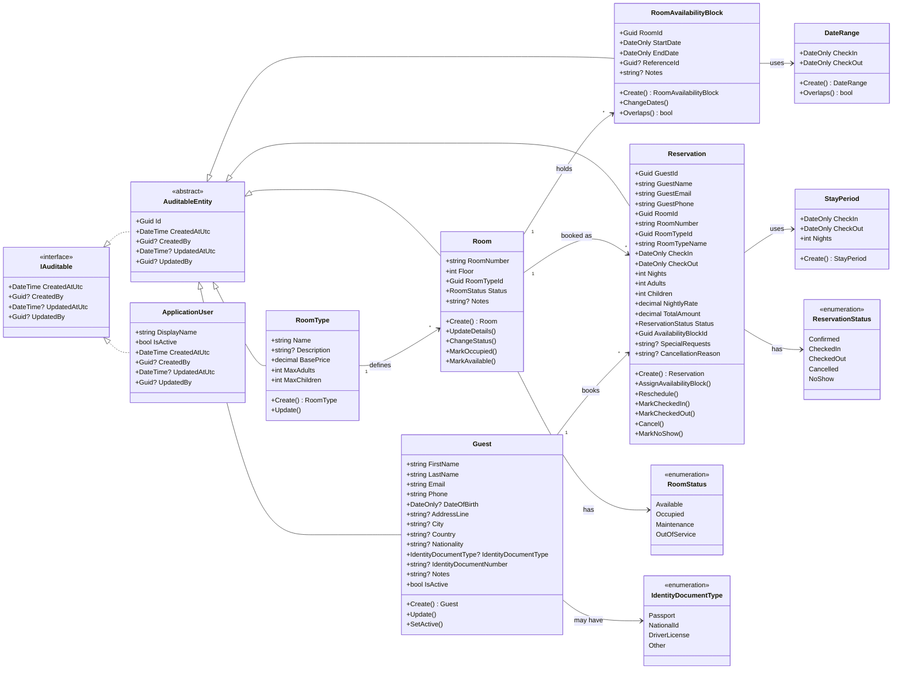

### 7.2 Domain Modeling Approach

The domain is DDD-lite:

- Entities have private setters and static factory methods.
- Domain methods enforce invariants.
- Value objects (`DateRange`, `StayPeriod`) are readonly record structs.
- No domain events, aggregates with child collections, or unit-of-work abstractions beyond DbContext.
- No anemic public setters exposed to controllers.
- Persistence configurations use EF Core `IEntityTypeConfiguration`.

This provides a strong domain core without the ceremony of full DDD.

### 7.3 Auth Domain

`UserAdministrationRules` is a stateless domain policy:

- Remove own Owner role: blocked with `DomainException` → `400`.
- Demote the last active Owner: blocked with `ConflictException` → `409`.
- Deactivate own account: blocked with `DomainException` → `400`.
- Deactivate the last active Owner: blocked with `ConflictException` → `409`.

Role names are canonicalized case-insensitively by `RoleNameNormalizer`. Unknown roles produce a structured validation error.

### 7.4 Rooms Domain Invariants

Room type:

- Name required, trimmed, max 100.
- Description optional, max 500.
- Base price non-negative, rounded to 2 decimals away from zero.
- Adults 1–20; children 0–20.

Room:

- Number required, trimmed, uppercased, max 20.
- Floor 0–200.
- Room type GUID required.
- Status must be a defined enum.
- Notes optional, max 500.
- `MarkOccupied`: `Available` → `Occupied`; no-op if already `Occupied`; otherwise domain error.
- `MarkAvailable`: `Occupied` or any other status except maintenance/out-of-service → `Available`; maintenance/out-of-service are preserved.

Availability block:

- Room ID required.
- Date range valid and half-open.
- Notes optional, max 500.
- `Overlaps(checkIn, checkOut)` uses `StartDate < checkOut && checkIn < EndDate`.
- `ChangeDates` validates the new range.

Date range:

- Both dates required.
- Check-out strictly after check-in.
- Overlap is half-open, so adjacent stays are allowed.

### 7.5 Guests Domain Invariants

- First name required, max 100.
- Last name required, max 100.
- Email required, max 254, lowercased, must contain `@` not at start/end. Validators also use `EmailAddress()`.
- Phone required, max 30.
- Date of birth optional; if supplied, between 1900-01-01 and today.
- Address max 250; city/country/nationality max 100; notes max 1000.
- Document type must be a defined enum.
- Document type and number must be supplied together; number max 50.
- Status is boolean `IsActive`; no hard deletion.

### 7.6 Reservations Domain Invariants

Reservation creation:

- Guest ID, room ID, room type ID required.
- Adults 1–20; children 0–20.
- Nightly rate non-negative, rounded to 2 decimals.
- Guest/room snapshots required and length-limited.
- Nights derived from stay period.
- Total = nightly rate × nights, rounded to 2 decimals.
- Initial status `Confirmed`.
- Block ID assigned once.

Transitions:

- `Reschedule` only from `Confirmed`; preserves nightly rate, recalculates total.
- `MarkCheckedIn` only from `Confirmed`.
- `MarkCheckedOut` only from `CheckedIn`.
- `Cancel` only from `Confirmed`; reason optional, max 500.
- `MarkNoShow` only from `Confirmed`.
- Terminal statuses cannot transition again.

`StayPeriod` computes nights as `checkOut.DayNumber - checkIn.DayNumber`, so a same-day check-out is rejected.

### 7.7 Application Services

| Service | Methods | Notes |
|---|---|---|
| `AuthService` | `LoginAsync` | Validates, normalizes email, calls Identity, creates token |
| `UserAdministrationService` | `GetCurrentUserAsync`, `GetByIdAsync`, `GetUsersAsync`, `CreateUserAsync`, `UpdateRolesAsync`, `SetActiveAsync`, `GetRolesAsync` | Enforces Owner rules |
| `RoomTypeService` | `GetAllAsync`, `GetByIdAsync`, `CreateAsync`, `UpdateAsync` | Unique name |
| `RoomService` | `GetByIdAsync`, `GetInternalAsync`, `GetPagedAsync`, `GetAvailableAsync`, `CreateAsync`, `UpdateAsync`, `ChangeStatusAsync`, `SetOccupancyAsync` | Inventory + occupancy |
| `AvailabilityService` | `CreateBlockAsync`, `RescheduleBlockAsync`, `ReleaseBlockAsync`, `CheckAvailabilityAsync` | Serializable create/move |
| `GuestService` | `GetByIdAsync`, `GetSummaryAsync`, `GetPagedAsync`, `CreateAsync`, `UpdateAsync`, `ChangeStatusAsync` | Unique email |
| `ReservationService` | `GetByIdAsync`, `GetPagedAsync`, `CreateAsync`, `CheckInAsync`, `CheckOutAsync`, `RescheduleAsync`, `CancelAsync`, `MarkNoShowAsync` | Saga-like orchestration |

### 7.8 DTOs and Validators

DTOs are positional records. Request DTOs are validated by FluentValidation before domain construction. Response DTOs are built by extension methods in `Mappings`.

Validation layers:

1. **FluentValidation** for shape, ranges, enum definitions, lengths, and cross-field checks.
2. **Domain guards** for the same invariants plus normalization.
3. **Database constraints** for a final safety net.

The duplication is intentional: validators give good API errors; domain guards protect all entry points; database constraints protect against bugs and manual SQL.

---

## 8. Data Design

### 8.1 Data Ownership

| Data | Owner | Consumers |
|---|---|---|
| Users, password hashes, roles, role assignments | Auth | Auth only |
| Room types, rooms, statuses, availability blocks | Rooms | Rooms; Reservations via internal API |
| Guest profiles and active state | Guests | Guests; Reservations via internal API |
| Reservations, snapshots, totals, lifecycle | Reservations | Reservations; clients via API |

No service reads another service's database. Cross-service references are logical GUIDs with no physical foreign key.

### 8.2 Logical ER Diagram

Cross-database relationships are dashed and logical only.

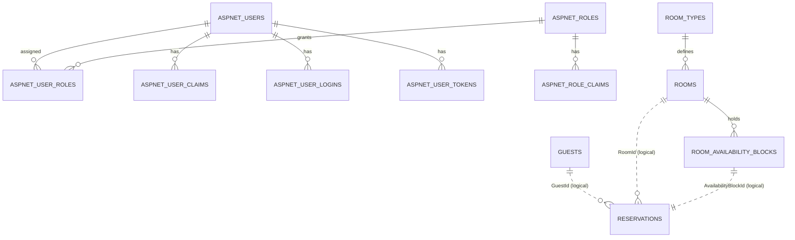

### 8.3 Physical Database Diagram

The diagram shows key columns and relationships. Full column catalogs follow in Section 8.4.

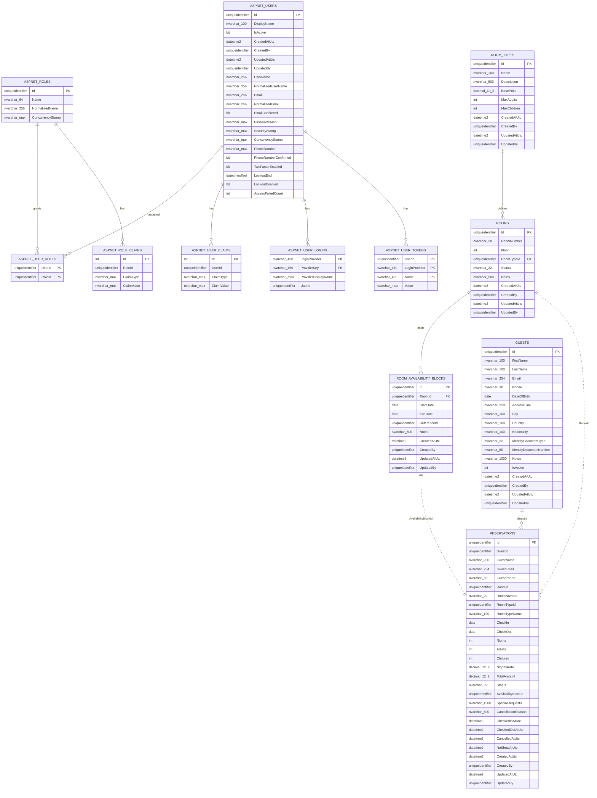

### 8.4 Table Catalog

#### 8.4.1 HotelAuth

`AspNetUsers`

| Column | Type | Constraints/notes |
|---|---|---|
| `Id` | uniqueidentifier | PK |
| `DisplayName` | nvarchar(100) | required, check `LEN > 0` |
| `IsActive` | bit | required, default true |
| `CreatedAtUtc` | datetime2 | required |
| `CreatedBy` | uniqueidentifier | nullable |
| `UpdatedAtUtc` | datetime2 | nullable |
| `UpdatedBy` | uniqueidentifier | nullable |
| `UserName` | nvarchar(256) | Identity |
| `NormalizedUserName` | nvarchar(256) | unique filtered index |
| `Email` | nvarchar(256) | Identity |
| `NormalizedEmail` | nvarchar(256) | unique filtered index `EmailIndex` |
| `EmailConfirmed` | bit | required |
| `PasswordHash` | nvarchar(max) | Identity |
| `SecurityStamp` | nvarchar(max) | Identity |
| `ConcurrencyStamp` | nvarchar(max) | Identity |
| `PhoneNumber` | nvarchar(max) | nullable |
| `PhoneNumberConfirmed` | bit | required |
| `TwoFactorEnabled` | bit | required |
| `LockoutEnd` | datetimeoffset | nullable |
| `LockoutEnabled` | bit | required |
| `AccessFailedCount` | int | required |

`AspNetRoles`

| Column | Type | Constraints/notes |
|---|---|---|
| `Id` | uniqueidentifier | PK |
| `Name` | nvarchar(64) | required by Identity behavior |
| `NormalizedName` | nvarchar(256) | unique filtered `RoleNameIndex` |
| `ConcurrencyStamp` | nvarchar(max) | nullable |

`AspNetUserRoles` has composite PK `(UserId, RoleId)` and FKs to users/roles with cascade delete. The remaining Identity tables are `AspNetRoleClaims`, `AspNetUserClaims`, `AspNetUserLogins`, and `AspNetUserTokens`.

#### 8.4.2 HotelRooms

`RoomTypes`

| Column | Type | Constraints/notes |
|---|---|---|
| `Id` | uniqueidentifier | PK |
| `Name` | nvarchar(100) | required, unique index |
| `Description` | nvarchar(500) | nullable |
| `BasePrice` | decimal(10,2) | required, check >= 0 |
| `MaxAdults` | int | required |
| `MaxChildren` | int | required |
| audit columns | | `CreatedAtUtc`, `CreatedBy`, `UpdatedAtUtc`, `UpdatedBy` |

`Rooms`

| Column | Type | Constraints/notes |
|---|---|---|
| `Id` | uniqueidentifier | PK |
| `RoomNumber` | nvarchar(20) | required, unique index, check non-empty |
| `Floor` | int | required, check 0–200 |
| `RoomTypeId` | uniqueidentifier | FK → RoomTypes, delete restrict |
| `Status` | nvarchar(32) | required, stored as string |
| `Notes` | nvarchar(500) | nullable |
| audit columns | | |

`RoomAvailabilityBlocks`

| Column | Type | Constraints/notes |
|---|---|---|
| `Id` | uniqueidentifier | PK |
| `RoomId` | uniqueidentifier | FK → Rooms, delete restrict |
| `StartDate` | date | required |
| `EndDate` | date | required, check `EndDate > StartDate` |
| `ReferenceId` | uniqueidentifier | nullable; reservation ID for traceability |
| `Notes` | nvarchar(500) | nullable |
| audit columns | | |

Indexes:

- `IX_Rooms_RoomNumber` unique.
- `IX_Rooms_RoomTypeId`.
- `IX_RoomTypes_Name` unique.
- `IX_RoomAvailabilityBlocks_RoomId_StartDate_EndDate`.
- `IX_RoomAvailabilityBlocks_ReferenceId`.

#### 8.4.3 HotelGuests

`Guests`

| Column | Type | Constraints/notes |
|---|---|---|
| `Id` | uniqueidentifier | PK |
| `FirstName` | nvarchar(100) | required, check non-empty |
| `LastName` | nvarchar(100) | required, check non-empty |
| `Email` | nvarchar(254) | required, unique index, check non-empty |
| `Phone` | nvarchar(30) | required, check non-empty |
| `DateOfBirth` | date | nullable |
| `AddressLine` | nvarchar(250) | nullable |
| `City` | nvarchar(100) | nullable |
| `Country` | nvarchar(100) | nullable |
| `Nationality` | nvarchar(100) | nullable |
| `IdentityDocumentType` | nvarchar(32) | nullable, stored as string |
| `IdentityDocumentNumber` | nvarchar(50) | nullable |
| `Notes` | nvarchar(1000) | nullable |
| `IsActive` | bit | required |
| audit columns | | |

Indexes: unique `IX_Guests_Email`; `IX_Guests_IsActive`.

#### 8.4.4 HotelReservations

`Reservations`

| Column | Type | Constraints/notes |
|---|---|---|
| `Id` | uniqueidentifier | PK |
| `GuestId` | uniqueidentifier | logical reference to Guests |
| `GuestName` | nvarchar(200) | snapshot, required |
| `GuestEmail` | nvarchar(254) | snapshot, required |
| `GuestPhone` | nvarchar(30) | snapshot, required |
| `RoomId` | uniqueidentifier | logical reference to Rooms |
| `RoomNumber` | nvarchar(20) | snapshot, required |
| `RoomTypeId` | uniqueidentifier | snapshot |
| `RoomTypeName` | nvarchar(100) | snapshot, required |
| `CheckIn` | date | required, check `CheckOut > CheckIn` |
| `CheckOut` | date | required |
| `Nights` | int | required, check `> 0` |
| `Adults` | int | check 1–20 |
| `Children` | int | check 0–20 |
| `NightlyRate` | decimal(12,2) | check >= 0 |
| `TotalAmount` | decimal(12,2) | check >= 0 |
| `Status` | nvarchar(32) | required, stored as string |
| `AvailabilityBlockId` | uniqueidentifier | unique index, logical reference |
| `SpecialRequests` | nvarchar(1000) | nullable |
| `CancellationReason` | nvarchar(500) | nullable |
| `CheckedInAtUtc` | datetime2 | nullable |
| `CheckedOutAtUtc` | datetime2 | nullable |
| `CancelledAtUtc` | datetime2 | nullable |
| `NoShowAtUtc` | datetime2 | nullable |
| audit columns | | |

Indexes:

- Unique `IX_Reservations_AvailabilityBlockId`.
- `IX_Reservations_GuestId`.
- `IX_Reservations_RoomId`.
- `IX_Reservations_RoomId_CheckIn_CheckOut`.
- `IX_Reservations_Status`.

### 8.5 Data Types and Normalization

- GUIDs are `uniqueidentifier` and generated application-side, which allows IDs to be known before save and supports compensation references.
- Calendar dates are SQL `date` via `DateOnly`.
- Timestamps are UTC `datetime2`; audit/user timestamps are application-supplied.
- Enums are stored as strings for readability and resilience to numeric reordering.
- Money uses `decimal`, not floating point.
- Room numbers and guest emails are normalized application-side for uniqueness; SQL unique indexes are case-sensitive by default collation, so application normalization is essential.
- Strings are trimmed before persistence.

### 8.6 Cross-Service References and Snapshots

- `Reservations.GuestId` is not a foreign key to `HotelGuests`.
- `Reservations.RoomId` and `RoomTypeId` are not foreign keys to `HotelRooms`.
- `Reservations.AvailabilityBlockId` is not a foreign key to `HotelRooms`.
- `RoomAvailabilityBlocks.ReferenceId` optionally stores the reservation ID.
- Reservation snapshot fields preserve the guest and room values at booking time.
- A guest name change does not rewrite existing reservations.
- A room number or room type change does not rewrite existing reservations.
- Renaming a room type does not change historical reservation labels.
- The nightly rate is snapshotted from the room type base price at booking; later price changes do not affect existing reservations.

This is a deliberate trade-off: historical accuracy over live referential consistency.

### 8.7 Migration Strategy

Each service has a single `InitialCreate` migration:

| Service | Migration path |
|---|---|
| Auth | `src/Services/Auth/HotelManagement.Auth.Infrastructure/Persistence/Migrations` |
| Rooms | `src/Services/Rooms/HotelManagement.Rooms.Infrastructure/Persistence/Migrations` |
| Guests | `src/Services/Guests/HotelManagement.Guests.Infrastructure/Migrations` |
| Reservations | `src/Services/Reservations/HotelManagement.Reservations.Infrastructure/Migrations` |

Startup behavior:

- Auth: migrate, seed roles, seed/repair bootstrap Owner.
- Rooms: migrate.
- Guests: migrate.
- Reservations: migrate.

Operational guidance:

- Apply migrations manually before starting multiple instances to avoid concurrent migration races.
- In production, use a dedicated migration job rather than startup migration.
- Never point integration tests at development databases; the factories replace the target database.
- Back up before destructive schema changes.

### 8.8 Reporting and Query Constraints

The current schema supports operational queries used by the APIs:

- Paged room, guest, reservation, and user lists.
- Availability by date range.
- Internal lookups by ID.
- Reservation search by guest name/email or room number.

There is no reporting warehouse, denormalized read model, or cross-service join. Reporting would require an analytical store or API composition. Current `Contains` searches are not full-text and may table-scan at scale.

---

## 9. API Design

### 9.1 Standards

- ASP.NET Core controllers with `[ApiController]`.
- JSON request/response bodies.
- Enums serialized as strings with `JsonStringEnumConverter` in Rooms, Guests, and Reservations. Auth has no enum payloads.
- Problem details for errors.
- Paged responses use `PagedResult<T>`.
- Collection creation returns `201 Created` with a `Location` header via `CreatedAtAction`.
- Resource updates return `200`.
- Internal block deletion returns `204`.
- No API version prefix in routes; Swagger document version is `v1`.
- No HATEOAS, ETags, JSON:API, or idempotency-key support.

### 9.2 Public Endpoint Catalog

| Service | Method | Path | Policy |
|---|---|---|---|
| Auth | POST | `/api/auth/login` | Anonymous |
| Auth | GET | `/api/auth/me` | Authenticated |
| Auth | GET | `/api/auth/users` | OwnerOnly |
| Auth | GET | `/api/auth/users/{id}` | OwnerOnly |
| Auth | POST | `/api/auth/users` | OwnerOnly |
| Auth | PUT | `/api/auth/users/{id}/roles` | OwnerOnly |
| Auth | POST | `/api/auth/users/{id}/activate` | OwnerOnly |
| Auth | POST | `/api/auth/users/{id}/deactivate` | OwnerOnly |
| Auth | GET | `/api/auth/roles` | OwnerOnly |
| Rooms | GET | `/api/room-types` | Operations |
| Rooms | GET | `/api/room-types/{id}` | Operations |
| Rooms | POST | `/api/room-types` | Management |
| Rooms | PUT | `/api/room-types/{id}` | Management |
| Rooms | GET | `/api/rooms` | Operations |
| Rooms | GET | `/api/rooms/available` | Operations |
| Rooms | GET | `/api/rooms/{id}` | Operations |
| Rooms | POST | `/api/rooms` | Management |
| Rooms | PUT | `/api/rooms/{id}` | Management |
| Rooms | PUT | `/api/rooms/{id}/status` | Operations |
| Guests | GET | `/api/guests` | Operations |
| Guests | GET | `/api/guests/{id}` | Operations |
| Guests | POST | `/api/guests` | Management |
| Guests | PUT | `/api/guests/{id}` | Management |
| Guests | PUT | `/api/guests/{id}/status` | Management |
| Reservations | GET | `/api/reservations` | Operations |
| Reservations | GET | `/api/reservations/{id}` | Operations |
| Reservations | POST | `/api/reservations` | Operations |
| Reservations | POST | `/api/reservations/{id}/check-in` | Operations |
| Reservations | POST | `/api/reservations/{id}/check-out` | Operations |
| Reservations | POST | `/api/reservations/{id}/no-show` | Operations |
| Reservations | PUT | `/api/reservations/{id}/reschedule` | Operations |
| Reservations | PUT | `/api/reservations/{id}/cancel` | Operations |

The public surface contains 32 routes. All are available through the gateway except direct service access.

### 9.3 Internal Endpoint Catalog

| Method | Path | Purpose |
|---|---|---|
| GET | `/internal/rooms/{roomId}` | Room capacity, price, status, operational flag |
| POST | `/internal/rooms/{roomId}/availability-blocks` | Create hold |
| PUT | `/internal/rooms/{roomId}/occupancy` | Set occupied/available |
| PUT | `/internal/availability-blocks/{blockId}` | Move hold |
| DELETE | `/internal/availability-blocks/{blockId}` | Release hold |
| GET | `/internal/rooms/{roomId}/availability` | Check a date range |
| GET | `/internal/guests/{id}` | Guest summary |

Internal routes are excluded from Swagger with `[ApiExplorerSettings(IgnoreApi = true)]`, not routed by Ocelot, and protected by `X-Internal-Api-Key`. The key check runs before authentication and applies to any path under `/internal`.

### 9.4 Error Model

Problem details shape:

```json
{
  "type": "https://httpstatuses.com/409",
  "title": "Conflict.",
  "status": 409,
  "detail": "The room already has an availability block for the requested dates.",
  "instance": "/api/reservations",
  "traceId": "0HN...",
  "correlationId": "caller-supplied-or-generated",
  "errors": {
    "CheckOut": ["Check-out date must be after check-in date."]
  }
}
```

`errors` appears only for validation failures. `traceId` is `HttpContext.TraceIdentifier`; `correlationId` is added when present.

### 9.5 Authorization Matrix

| Capability | Owner | Manager | Receptionist |
|---|:---:|:---:|:---:|
| Login / read self | Yes | Yes | Yes |
| Manage users/roles | Yes | No | No |
| Manage room types/rooms | Yes | Yes | No |
| Change room status | Yes | Yes | Yes |
| Read inventory | Yes | Yes | Yes |
| Manage guests | Yes | Yes | No |
| Read guests | Yes | Yes | Yes |
| Manage reservations | Yes | Yes | Yes |
| Internal endpoints | Key | Key | Key |

Authorization is enforced per controller/action using policies, not by the gateway. A missing/invalid token yields `401`; an authenticated user without the role yields `403`.

### 9.6 Pagination and Filtering

| Endpoint | Query parameters |
|---|---|
| Users | `page`, `pageSize`, `search` |
| Rooms | `page`, `pageSize`, `search`, `status`, `roomTypeId`, `floor` |
| Guests | `page`, `pageSize`, `search`, `isActive` |
| Reservations | `page`, `pageSize`, `search`, `status`, `guestId` |

`page` is normalized to at least 1; `pageSize` is clamped to 1–100. Total pages are computed as `ceil(totalCount / pageSize)`.

### 9.7 Why No API Versioning

The API is an internal staff backend with a single deployed client ecosystem. Route-level versioning was not needed for the baseline. Swagger uses `v1` as a document label. Future breaking changes should introduce `/api/v2` or header-based versioning.

---

## 10. Workflows and Sequences

### 10.1 Login Sequence

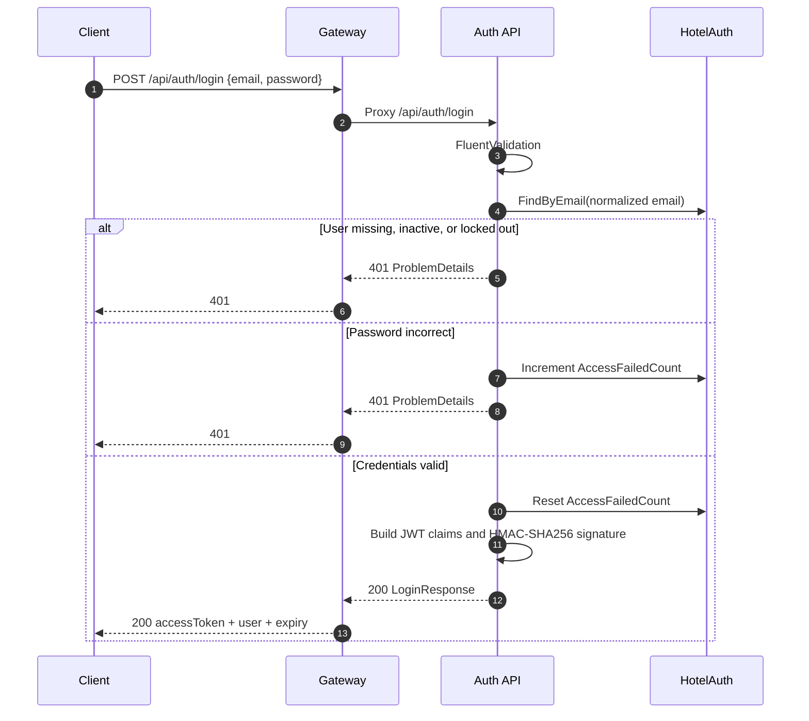

Security notes:

- Unknown users and wrong passwords return the same `401` detail.
- Inactive users are rejected before password verification.
- Locked-out users are rejected before password verification.
- Successful login resets the failed count.
- The JWT contains no password or security-stamp claim.

### 10.2 Create Reservation Sequence

```mermaid
sequenceDiagram
    autonumber
    participant C as Client
    participant G as Gateway
    participant R as Reservations API
    participant GDB as HotelReservations
    participant GS as Guests API
    participant RS as Rooms API
    participant RDB as HotelRooms

    C->>G: POST /api/reservations
    G->>R: Proxy
    R->>R: Validate request
    R->>GS: GET /internal/guests/{guestId}
    GS-->>R: GuestSummaryDto or 404
    alt Guest missing or inactive
        R-->>G: 404 or 409
        G-->>C: Error
    else Guest valid
        R->>RS: GET /internal/rooms/{roomId}
        RS->>RDB: Load room + room type
        RS-->>R: InternalRoomDto or 404
        alt Room missing, non-operational, or too small
            R-->>G: 404 or 409
            G-->>C: Error
        else Room valid
            R->>R: Create snapshots, nights, total
            R->>RS: POST /internal/rooms/{id}/availability-blocks
            RS->>RDB: BEGIN SERIALIZABLE
            RS->>RDB: Check overlap
            alt Overlap or non-operational
                RS-->>R: 409
                R-->>G: 409
                G-->>C: Conflict
            else No overlap
                RS->>RDB: INSERT block; COMMIT
                RS-->>R: 201 AvailabilityBlockDto
                R->>GDB: INSERT reservation
                alt Local save fails
                    R->>RS: DELETE block (compensation)
                    R-->>G: Error
                    G-->>C: Error
                else Save succeeds
                    R-->>G: 201 ReservationDto
                    G-->>C: 201
                end
            end
        end
    end
```

### 10.3 Reschedule Sequence

```mermaid
sequenceDiagram
    autonumber
    participant C as Client
    participant G as Gateway
    participant R as Reservations API
    participant RDB as HotelReservations
    participant RS as Rooms API
    participant RoomsDB as HotelRooms

    C->>G: PUT /api/reservations/{id}/reschedule
    G->>R: Proxy
    R->>R: Validate dates
    R->>RDB: Find reservation
    RDB-->>R: Reservation
    alt Not Confirmed or no block
        R-->>G: 400 or 409
        G-->>C: Error
    else Eligible
        R->>RS: PUT /internal/availability-blocks/{blockId}
        RS->>RoomsDB: BEGIN SERIALIZABLE
        RS->>RoomsDB: Load block and room
        RS->>RoomsDB: Check overlap excluding current block
        alt New range overlaps another block
            RS->>RoomsDB: ROLLBACK
            RS-->>R: 409
            R-->>G: 409
            G-->>C: Conflict; original stay unchanged
        else No overlap
            RS->>RoomsDB: UPDATE block dates; COMMIT
            RS-->>R: 200 updated block
            R->>RDB: Update dates, nights, total at existing rate
            alt Local save fails
                R->>RS: PUT block back to original dates
                R-->>G: Error
                G-->>C: Error
            else Save succeeds
                R-->>G: 200 ReservationDto
                G-->>C: 200
            end
        end
    end
```

### 10.4 Check-In and Check-Out Sequences

#### Check-in

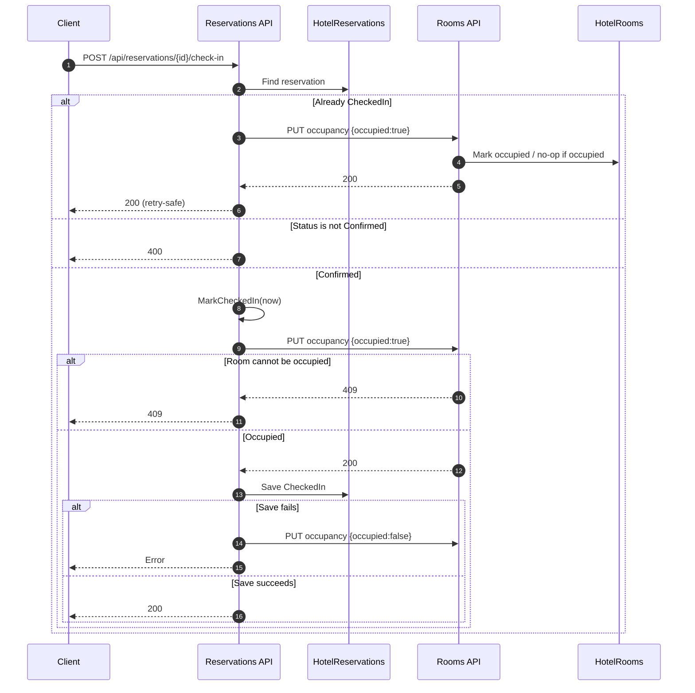

#### Check-out

```mermaid
sequenceDiagram
    autonumber
    participant C as Client
    participant R as Reservations API
    participant RDB as HotelReservations
    participant RS as Rooms API
    participant RoomsDB as HotelRooms

    C->>R: POST /api/reservations/{id}/check-out
    R->>RDB: Find reservation
    alt Already CheckedOut
        R->>RS: Release block
        R->>RS: PUT occupancy {occupied:false}
        R-->>C: 200 (retry-safe sync)
    else Not CheckedIn
        R-->>C: 400
    else CheckedIn
        R->>R: MarkCheckedOut(now)
        R->>RDB: Save CheckedOut
        R->>RS: DELETE /internal/availability-blocks/{blockId}
        RS->>RoomsDB: Delete block
        R->>RS: PUT occupancy {occupied:false}
        RS->>RoomsDB: Mark available
        alt Downstream failure
            R-->>C: 503; status may already be CheckedOut
        else Success
            R-->>C: 200
        end
    end
```

### 10.5 Cancel and No-Show Sequence

```mermaid
sequenceDiagram
    autonumber
    participant C as Client
    participant R as Reservations API
    participant RDB as HotelReservations
    participant RS as Rooms API
    participant RoomsDB as HotelRooms

    C->>R: PUT /api/reservations/{id}/cancel
    R->>R: Validate reason
    R->>RDB: Find reservation
    alt Not Confirmed
        R-->>C: 400
    else Confirmed
        R->>RS: DELETE /internal/availability-blocks/{blockId}
        RS->>RoomsDB: Delete block
        alt Release fails
            R-->>C: 503
        else Released
            R->>R: Cancel(reason, now)
            R->>RDB: Save Cancelled
            alt Save fails
                R-->>C: Error; hold already released
            else Saved
                R-->>C: 200
            end
        end
    end
```

No-show follows the same shape without a request body and sets `NoShowAtUtc`.

### 10.6 Availability and Overlap Algorithm

Availability for a room and a requested range `[checkIn, checkOut)`:

1. Validate `checkOut > checkIn`.
2. Load the room.
3. If status is `Maintenance` or `OutOfService`, return unavailable.
4. Otherwise, query for any block where:

```text
block.RoomId == roomId
AND block.StartDate < checkOut
AND checkIn < block.EndDate
```

5. If any block exists, return unavailable; otherwise available.
6. `GET /api/rooms/available` applies the same overlap predicate as a correlated `NOT EXISTS` and excludes non-operational statuses.

The half-open predicate means:

- A block ending on 2027-08-12 and a stay starting on 2027-08-12 do not overlap.
- A block ending on 2027-08-12 and a stay ending on 2027-08-12 overlap if the stay starts earlier.

Block creation:

1. Validate.
2. Open a serializable transaction.
3. Load the room and reject non-operational status.
4. Check overlap excluding no block.
5. Insert the block.
6. Commit.

Block reschedule:

1. Validate.
2. Open a serializable transaction.
3. Load the block and its room.
4. Reject non-operational status.
5. Check overlap excluding the current block ID.
6. Update dates.
7. Commit.

Serializable isolation is the key protection. The index on `(RoomId, StartDate, EndDate)` gives SQL Server a range to lock. Two concurrent overlapping requests cannot both pass the overlap check and commit. The integration test asserts exactly one `201` and one `409`.

### 10.7 Reservation State Diagram

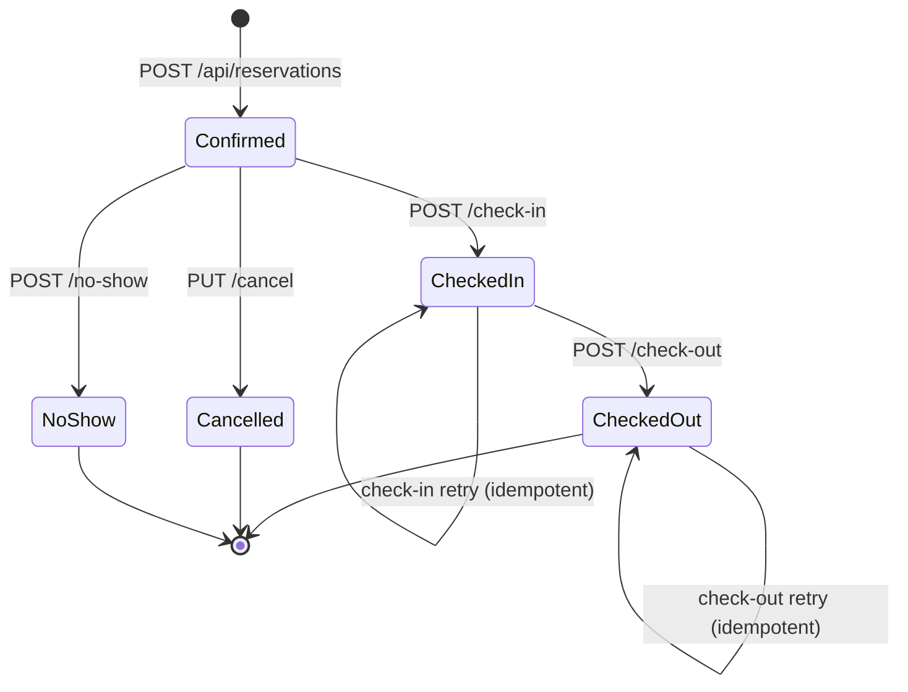

`Cancelled`, `CheckedOut`, and `NoShow` are terminal. There is no reopen or undo endpoint. A future rebooking must create a new reservation.

### 10.8 Gateway Request Path

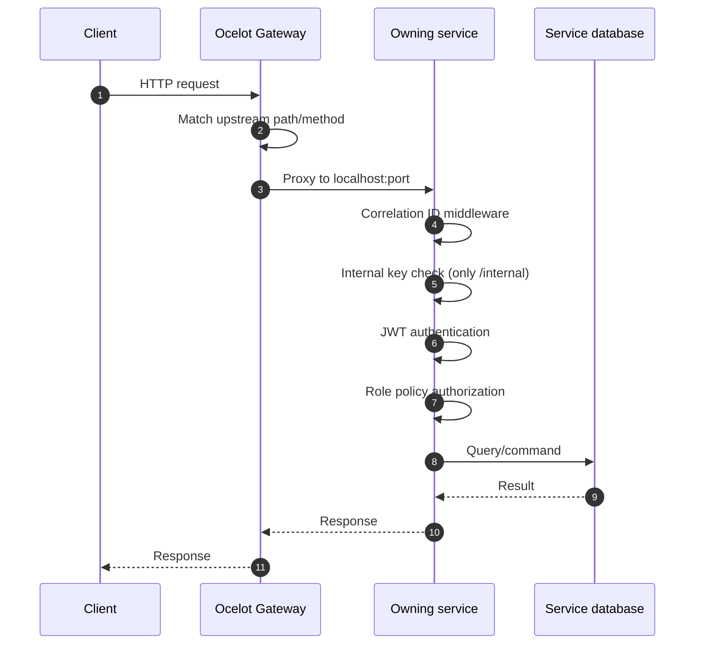

The gateway has no JWT middleware and no `Authorization` policy. This is deliberate: each service is independently defensible, including when accessed directly on its port.

---

## 11. Transactions, Consistency, and Failure Handling

### 11.1 Local Transactions

Each service persists through EF Core `SaveChanges`, which is transactional per call. SQL Server transient faults are retried with `EnableRetryOnFailure(maxRetryCount: 5, maxRetryDelay: 10s)`.

No service uses explicit local transactions except the Rooms availability create/move operations, which use serializable transactions.

### 11.2 Distributed Consistency Model

There is no distributed transaction, two-phase commit, outbox, or message broker. Reservation workflows are sagas implemented in application code with best-effort compensation.

| Workflow | Forward steps | Compensation |
|---|---|---|
| Create reservation | lookup guest → lookup room → hold block → save reservation | release block if save fails |
| Reschedule | move block → save reservation | move block back if save fails |
| Check-in | occupy room → save reservation | release occupancy if save fails |
| Check-out | save `CheckedOut` → release block → release occupancy | none; retry downstream sync |
| Cancel | release block → save `Cancelled` | none; known inconsistency risk |
| No-show | release block → save `NoShow` | none; known inconsistency risk |

Compensation failures are logged. There is no dead-letter queue and no automatic retry worker.

### 11.3 Failure Matrix

| Failure point | Immediate result | Data state | Recovery |
|---|---|---|---|
| Guests unavailable during create | `503` | No reservation, no block | Retry request |
| Room lookup unavailable during create | `503` | No reservation, no block | Retry request |
| Hold succeeds, local save fails | Error | Compensation attempts block release | Retry if release succeeded; inspect if not |
| Hold succeeds, compensation fails | Error | Orphan block | Manual cleanup by `ReferenceId` |
| Reschedule block move succeeds, save fails | Error | Compensation attempts original dates | Retry or inspect |
| Reschedule compensation fails | Error | Block dates and reservation dates diverge | Manual reconciliation |
| Check-in occupancy succeeds, save fails | Error | Compensation attempts available | Retry or inspect |
| Check-in compensation fails | Error | Room occupied, reservation confirmed | Manual reconciliation |
| Check-out status saved, block release fails | `503` | Reservation checked out, block may remain | Retry checkout |
| Cancel block released, save fails | Error | Hold gone, reservation confirmed | Manual correction; known limitation |
| Gateway downstream unavailable | `502`/`503`/`504` depending on Ocelot | No state change | Retry |

### 11.4 Consistency Invariants

The system attempts to maintain:

1. A confirmed reservation has one availability block.
2. A reservation's block covers its stay dates.
3. A room has no overlapping blocks.
4. A checked-in reservation's room is `Occupied`.
5. A checked-out reservation's hold is released and the room is `Available`.
6. A cancelled/no-show reservation's hold is released.
7. Reservation snapshots do not change when guest/room master data changes.

Some invariants can be temporarily violated after partial failure. The system has no reconciliation job, so manual inspection is required in those rare cases.

### 11.5 Idempotency

| Operation | Idempotent? | Notes |
|---|---|---|
| Login | Not state-idempotent | Each call issues a new JWT; failed count changes |
| Create reservation | No | Repeated calls create multiple reservations |
| Hold block | No | Repeated calls attempt new blocks |
| Release block | Yes-ish | Missing block returns `404`; Reservations treats `false` as already released |
| Reschedule | No | Repeating applies the same target dates; second call is effectively a no-op if still confirmed |
| Cancel | No | Second call returns `400` |
| No-show | No | Second call returns `400` |
| Check-in | Yes | Repeated check-in reasserts occupancy |
| Check-out | Yes | Repeated check-out resyncs downstream |

No `Idempotency-Key` header support exists. Client retries of create/cancel should be treated cautiously.

### 11.6 Concurrency

- Availability create/move is serializable.
- Room status changes and edits use last-write-wins.
- Reservation transitions read then write without row versions or optimistic concurrency tokens.
- Two operators could attempt to check in/out the same reservation concurrently; the database has no rowversion guard.
- EF Core retry strategy is enabled, but serializable transactions use the execution strategy explicitly.

Potential future improvement: add `rowversion` to reservations/rooms and return `409` on stale updates.

### 11.7 Money and Dates

- Nightly rate is snapshotted from the room type base price.
- Total = rate × nights, rounded with `MidpointRounding.AwayFromZero`.
- Reschedule preserves the original nightly rate.
- No taxes, fees, deposits, discounts, or currency conversion.
- Dates use SQL `date`, avoiding time-zone shifts for stay dates.
- Check-in/check-out timestamps use UTC, not hotel-local time.
- The system does not enforce that check-in occurs on the reservation date; this is left to staff procedure.

---

## 12. Security Design

### 12.1 Authentication

Auth issues JWTs signed with HMAC-SHA256. Every service validates:

- Issuer
- Audience
- Signing key
- Lifetime
- 30-second clock skew

Claims:

| Claim | Value |
|---|---|
| `sub` | User GUID |
| `ClaimTypes.Email` | User email |
| `ClaimTypes.Name` | Display name |
| `jti` | Random token ID |
| `iat` | Issued-at Unix seconds |
| `ClaimTypes.Role` | One claim per role |

The default token lifetime is 60 minutes. There are no refresh tokens, no sliding expiration, no token revocation list, and no logout endpoint.

### 12.2 Authorization

Policies:

| Policy | Roles |
|---|---|
| `Authenticated` | Any authenticated principal |
| `OwnerOnly` | Owner |
| `Management` | Owner, Manager |
| `Operations` | Owner, Manager, Receptionist |

Authorization is applied at controller or action level. Internal routes are not authorized by JWT policies; they are guarded by the internal key middleware.

### 12.3 Internal API Key

- Header: `X-Internal-Api-Key`.
- Key must be at least 32 bytes; validated at startup.
- Comparison uses `CryptographicOperations.FixedTimeEquals`.
- Middleware applies to every path starting with `/internal`.
- Missing/wrong key returns `401` with `WWW-Authenticate: InternalApiKey`.
- The key is not routed through the gateway.
- The same key is configured for Rooms, Guests, and Reservations.

Limitations:

- Static shared secret.
- No per-caller identity, rotation, or audit trail.
- If the key leaks, any network-reachable caller can invoke internal endpoints.
- Production should combine the key with network policy/mTLS and rotate via a secret manager.

### 12.4 Password and Account Policy

ASP.NET Core Identity policy:

- Minimum length 12.
- At least 4 unique characters.
- Requires uppercase, lowercase, digit, and non-alphanumeric.
- Unique email required.
- Email confirmation not required.
- Lockout enabled for new users.
- 5 failed attempts.
- 15-minute lockout.

Bootstrap Owner:

- Configured through environment variables.
- Created if absent.
- Reactivated if inactive.
- Ensured to have Owner role.
- Password is not reset automatically if the Owner already exists.
- If bootstrap credentials are absent, a warning is logged and no Owner is created.

Protections:

- Owners cannot remove their own Owner role.
- Owners cannot deactivate themselves.
- The last active Owner cannot be demoted or deactivated.
- Deactivation updates the security stamp, but existing JWTs still validate until expiry because services do not query the security stamp.

### 12.5 Secrets and Configuration

- Secrets are supplied via environment variables.
- `.env.local` is gitignored.
- `.env.example` contains placeholders only.
- JWT signing key and internal key must be at least 32 bytes.
- SQL SA credentials are used locally; production should use least-privilege SQL logins.
- Swagger is enabled only in Development.
- No secret is embedded in source code or committed configuration.
- There is no secret manager integration, key rotation, or encryption-at-rest configuration in the application.

### 12.6 Transport and Edge Security

Local development uses HTTP on localhost. Production should:

- Terminate TLS at the gateway or ingress.
- Redirect HTTP to HTTPS.
- Block direct access to service ports.
- Restrict `/internal` to service network segments.
- Add gateway rate limiting and request-size limits.
- Add WAF/API protection if internet-facing.
- Add CORS policy only if a browser client is introduced.

The current code has no CORS configuration, rate limiting, IP allow-list, or request throttling.

### 12.7 Threat Model (STRIDE)

| Threat | Example | Current control | Residual risk |
|---|---|---|---|
| Spoofing | Forged JWT | HMAC signature, issuer/audience/lifetime validation | Key compromise; no revocation |
| Spoofing | Caller impersonates Reservations | Internal API key | Static key, no per-service identity |
| Tampering | Overlapping hold via race | Serializable transaction, DB constraints | None known for block overlap |
| Tampering | Client changes price | Price comes from room type, not request | Room type edit by Manager changes future price    |
| Repudiation | Staff denies action | Audit fields, correlation ID | No immutable audit log/event history |
| Information disclosure | Stack traces | Global exception handler, generic 500 | No field-level PII masking |
| Information disclosure | Swagger exposed | Development only | Misconfigured environment could expose it |
| Denial of service | Request flood | None | No rate limit/WAF |
| Elevation of privilege | Receptionist edits inventory | Management policy | Policy bugs; direct service access |
| Elevation of privilege | Public internal endpoint | Gateway does not route internal; key required | Direct network exposure with leaked key |

### 12.8 Data Protection and Privacy

Data stored:

- User emails, display names, password hashes, lockout counters.
- Guest names, emails, phones, date of birth, address, nationality, identity document type/number, notes.
- Reservation stay history and guest/room snapshots.

Controls:

- Password hashes managed by Identity.
- Error details do not expose internal state.
- SQL Server encryption/TLS is deployment-dependent.
- No application-level encryption, masking, retention policy, export, or erasure workflow.
- Identity document numbers are sensitive PII; production should restrict access and consider encryption/tokenization.

### 12.9 Security Gaps

- No JWT revocation or introspection.
- No refresh-token rotation.
- No multi-factor authentication.
- No password reset/change endpoint.
- No account lockout unlock endpoint.
- No rate limiting or brute-force protection beyond Identity lockout.
- No security headers or CORS policy.
- No dependency vulnerability gate in CI.
- No audit event store.
- No internal key rotation.

These are documented as production-readiness work, not hidden assumptions.

---

## 13. Non-Functional Design

### 13.1 Performance

There are no load-test results in the repository. The design is sized for a small hotel back office; performance claims must be validated with a representative workload.

Characteristics:

- Each API is stateless and can be scaled horizontally.
- SQL Server is the shared bottleneck per service database.
- Availability queries use indexed columns.
- `Contains` search predicates are not full-text indexes and can scan.
- Available-room and room-type endpoints are unpaged; large inventories could produce large responses.
- Serializability may cause lock waits when many requests compete for the same room/dates.
- JWT validation is local and fast.
- Downstream HTTP adds latency to reservation workflows.
- No caching layer exists.

Proposed validation targets (not yet measured):

| Scenario | Proposed target |
|---|---|
| Simple authenticated read | p95 < 300 ms |
| Create reservation | p95 < 800 ms |
| Availability search | p95 < 500 ms for 500 rooms |
| Concurrent holds for one room | Correctness over throughput |
| Sustained throughput | Establish from pilot load test |

These targets are planning aids, not guarantees.

### 13.2 Scalability

Scale-out approach:

- Run multiple stateless API instances behind a load balancer/gateway.
- Use a SQL Server instance with sufficient CPU, memory, and IOPS.
- Scale Reservations independently from inventory if downstream latency dominates.
- Move to a managed SQL service with read replicas for read-heavy reporting (future).
- Run migrations as a separate job before scaling.

Current blockers:

- Fixed localhost ports in `ocelot.json`.
- Startup migrations can race across replicas.
- No distributed cache.
- No rate limiting.
- No outbox/worker for async compensation.
- No tenant/property partitioning.

### 13.3 Availability and Resilience

Current behavior:

- Each service has a DB-backed health check.
- SQL transient errors are retried 5 times.
- Downstream HTTP has a 15-second timeout.
- There is no circuit breaker, bulkhead, or retry for downstream HTTP calls.
- Gateway has no health aggregation.
- Single SQL instance and single process per service locally.
- No automated failover.

Failure semantics:

- If a downstream service is down, reservation workflows fail fast with `503` for direct clients; the gateway may return `502`/`504` depending on the failure.
- A failed hold is not retried automatically.
- A failed compensation is logged and left for manual reconciliation.

### 13.4 Observability

Implemented:

- ASP.NET Core logging to console.
- Correlation ID header and logging scope.
- Global exception logging.
- Health checks per DB.
- Swagger for manual exploration.

Not implemented:

- OpenTelemetry traces/metrics.
- Prometheus endpoint.
- Structured JSON logging.
- Centralized log aggregation.
- Distributed tracing across gateway/services.
- Business metrics (occupancy, booking failures, hold conflicts).
- Alerting.
- Audit event history.

Recommended production additions:

- Propagate `traceparent` and `X-Correlation-ID`.
- Export traces to an APM backend.
- Add RED/USE metrics and SLO alerts.
- Alert on DB health, 5xx rate, `503` downstream rate, hold conflict rate, and compensation failures.
- Retain logs per policy with PII redaction.

### 13.5 Maintainability

Strengths:

- Consistent project structure across services.
- Small, focused classes.
- Explicit DTOs and validators.
- Domain invariants tested.
- Integration tests exercise real HTTP and SQL.
- Formatting verified with `dotnet format`.
- Documentation includes setup, API, testing, and design.

Weaknesses:

- No centralized package management; versions repeat across projects.
- Some duplicated patterns across services (validators, mappings).
- No API client SDK.
- No architecture tests enforcing dependency rules.
- No CI pipeline in the repository.
- No code coverage gate.
- Error messages and some domain strings are duplicated.

### 13.6 Compatibility

- Target framework: `net10.0`.
- SDK pinned to `10.0.101` with `rollForward: latestFeature`.
- SQL Server image: `mcr.microsoft.com/mssql/server:2022-latest` in the documented setup.
- EF Core migrations target SQL Server.
- DateOnly mapping relies on EF Core SQL Server support.
- No cross-platform code beyond .NET and Docker SQL Server.

### 13.7 Capacity Assumptions

For planning only:

- Small hotel: tens to low hundreds of rooms.
- Tens of staff users.
- Low thousands of reservations per year.
- Peak concurrent staff users in the tens.
- Availability contention concentrated on popular dates.

At larger scale, add paging to inventory endpoints, full-text or indexed search, read models, and a dedicated reservation contention strategy.

---

## 14. Testing Strategy

The full testing guide is in `docs/TESTING.md`. This section records the design-level approach and current evidence.

### 14.1 Test Pyramid

```mermaid
flowchart TB
    E2E[Manual end-to-end through gateway]
    GW[Gateway integration tests<br/>11]
    INT[Service integration tests<br/>62]
    UNIT[Unit tests<br/>65]
    UNIT --> INT --> GW --> E2E
```

Counts: 65 unit tests, 62 service integration tests, 11 gateway integration tests, 138 total.

### 14.2 Suite Distribution

| Suite | Count |
|---|---:|
| Auth unit | 14 |
| Auth integration | 18 |
| Rooms unit | 18 |
| Rooms integration | 19 |
| Guests unit | 15 |
| Guests integration | 9 |
| Reservations unit | 18 |
| Reservations integration | 16 |
| Gateway integration | 11 |
| **Total** | **138** |

### 14.3 Integration Test Architecture

Service integration tests use:

- `WebApplicationFactory<Program>`.
- A real ASP.NET Core pipeline.
- A real SQL Server database per factory.
- In-memory configuration overrides.
- Real JWT generation with test issuer/audience/key.
- `ConfigureTestServices` to replace `DbContext` registrations.
- Unique database names.
- `EnsureDeleted` on disposal.
- Snake-case descriptive test names.

Reservation integration tests replace `IGuestDirectory` and `IRoomDirectory` with in-memory fakes. This isolates reservation orchestration from live downstream services while retaining real SQL persistence.

Gateway tests:

- Start an in-process stub downstream server on an ephemeral port.
- Generate a temporary Ocelot config with that port.
- Set `OCELOT_CONFIG_PATH` for the test.
- Verify routing, Swagger, health, and internal-route blocking.
- Restore the previous environment variable and delete the temp file on dispose.

### 14.4 Test Database Isolation

Critical rule: integration tests must never target the development databases.

Factory pattern:

1. Read connection template from environment.
2. Replace `InitialCatalog` with `Hotel<Service>Tests_<Guid>`.
3. Override configuration.
4. Remove existing `DbContextOptions<T>` and `DbContext` registrations.
5. Re-add the context with the test connection string and audit interceptor.
6. Let startup migrations run.
7. Delete only the test database on disposal.

This prevents the historical failure mode in which configuration ordering caused tests to migrate/delete the local development database.

### 14.5 Coverage Highlights

- RBAC for all three roles.
- Owner continuity.
- Case-insensitive uniqueness.
- Half-open overlap and adjacency.
- Concurrent block creation.
- Internal key enforcement.
- Reservation snapshots and totals.
- Status transition guards.
- Reschedule conflict preserving the original stay.
- Check-in occupancy and checkout release.
- Gateway route isolation.

### 14.6 Test Gaps

- Load/stress/soak tests.
- Fault injection for downstream failures during compensation.
- Contract tests between Reservations and downstream clients.
- Mutation testing and coverage thresholds.
- Browser E2E.
- Multi-instance startup/migration tests.
- Security scans and dependency gates.
- TLS/network policy tests.
- Data retention/PII tests.

---

## 15. Deployment and Operations

### 15.1 Local Topology

```mermaid
flowchart TB
    subgraph Dev[Developer machine]
        subgraph T1[Terminal 1]
            AUTH[Auth API :5111]
        end
        subgraph T2[Terminal 2]
            ROOMS[Rooms API :5112]
        end
        subgraph T3[Terminal 3]
            GUESTS[Guests API :5113]
        end
        subgraph T4[Terminal 4]
            RES[Reservations API :5114]
        end
        subgraph T5[Terminal 5]
            GW[Gateway :5110]
        end
    end

    subgraph Docker[SQL container hmnext-sql]
        SQL[(SQL Server :1433<br/>host :1434)]
    end

    GW --> AUTH
    GW --> ROOMS
    GW --> GUESTS
    GW --> RES
    RES -->|internal| ROOMS
    RES -->|internal| GUESTS
    AUTH --> SQL
    ROOMS --> SQL
    GUESTS --> SQL
    RES --> SQL
```

### 15.2 Startup Order

Recommended:

1. SQL Server.
2. Auth (creates roles and Owner).
3. Rooms.
4. Guests.
5. Reservations.
6. Gateway.

Strict order is not required for API startup, but Auth must be available for login, and Rooms/Guests must be available before reservation workflows. Each service applies its own migrations at startup.

### 15.3 Configuration Matrix

| Setting | Services | Required | Notes |
|---|---|---|---|
| `ConnectionStrings__AuthDb` | Auth | Yes | `HotelAuth` |
| `ConnectionStrings__RoomsDb` | Rooms | Yes | `HotelRooms` |
| `ConnectionStrings__GuestsDb` | Guests | Yes | `HotelGuests` |
| `ConnectionStrings__ReservationsDb` | Reservations | Yes | `HotelReservations` |
| `Jwt__Issuer` | All | Yes | Must match |
| `Jwt__Audience` | All | Yes | Must match |
| `Jwt__SigningKey` | All | Yes | >= 32 bytes, must match |
| `Jwt__ExpiryMinutes` | Auth | Yes | Default 60 |
| `Bootstrap__OwnerEmail` | Auth | Recommended | Owner bootstrap |
| `Bootstrap__OwnerPassword` | Auth | Recommended | Owner bootstrap |
| `InternalApi__Key` | Rooms, Guests, Reservations | Yes | >= 32 bytes, same value |
| `Services__RoomsBaseUrl` | Reservations | Yes | Absolute URL |
| `Services__GuestsBaseUrl` | Reservations | Yes | Absolute URL |
| `Services__TimeoutSeconds` | Reservations | No | Default 15 |
| `ASPNETCORE_ENVIRONMENT` | All | Development for Swagger | Swagger gated |
| `OCELOT_CONFIG_PATH` | Gateway | No | Defaults to `ocelot.json` |

### 15.4 Health Checks

| Service | Endpoint | Check |
|---|---|---|
| Gateway | `/health` | Process health |
| Auth | `/health` | `AuthDbContext` |
| Rooms | `/health` | `RoomsDbContext` |
| Guests | `/health` | `GuestsDbContext` |
| Reservations | `/health` | `ReservationsDbContext` |

Health checks are anonymous. They verify DB connectivity, not downstream service health. The gateway does not aggregate downstream health.

### 15.5 Migration Runbook

For a single local instance:

```bash
set -a
source .env.local
set +a

dotnet ef database update \
  --project src/Services/Auth/HotelManagement.Auth.Infrastructure \
  --startup-project src/Services/Auth/HotelManagement.Auth.Api

dotnet ef database update \
  --project src/Services/Rooms/HotelManagement.Rooms.Infrastructure \
  --startup-project src/Services/Rooms/HotelManagement.Rooms.Api

dotnet ef database update \
  --project src/Services/Guests/HotelManagement.Guests.Infrastructure \
  --startup-project src/Services/Guests/HotelManagement.Guests.Api

dotnet ef database update \
  --project src/Services/Reservations/HotelManagement.Reservations.Infrastructure \
  --startup-project src/Services/Reservations/HotelManagement.Reservations.Api
```

For multiple instances or production:

1. Run migrations as a one-off job.
2. Verify schema version.
3. Start application instances after migration success.
4. Keep startup migration as a fallback only for single-instance local development.

### 15.6 Backup and Recovery

Current local setup has no automated backup. Production guidance:

- Use SQL Server backups with a defined RPO/RTO.
- Back up Auth, Rooms, Guests, and Reservations consistently enough to reconcile.
- Test restore procedures.
- Preserve reservation snapshots; they are the historical record.
- Preserve `RoomAvailabilityBlocks.ReferenceId` for orphan-block tracing.
- Export logs before rotating/deleting them.

There is no reconciliation tool; recovery from partial distributed failures is manual.

### 15.7 Operational Checklist

Before starting:

- [ ] SQL container running and reachable.
- [ ] `.env.local` loaded.
- [ ] Secrets rotated for shared environments.
- [ ] Ports 5110–5114 free.
- [ ] Migrations applied or startup migration acceptable.
- [ ] Auth bootstrap configured.
- [ ] Internal key identical across Rooms/Guests/Reservations.
- [ ] Downstream base URLs correct.

After starting:

- [ ] `/health` returns `Healthy` on all five processes.
- [ ] Gateway `/swagger` loads in Development.
- [ ] Login works.
- [ ] Public route through gateway works.
- [ ] Internal route is not reachable through gateway.
- [ ] Internal route works directly with key.
- [ ] Correlation ID is echoed.

### 15.8 Production Hardening Checklist

- [ ] TLS everywhere; no plaintext service traffic.
- [ ] Secret manager with rotation for JWT and internal keys.
- [ ] Least-privilege SQL logins; no SA.
- [ ] Network policies isolate service and database ports.
- [ ] Gateway rate limiting, timeouts, and request-size limits.
- [ ] Centralized logs, metrics, and traces.
- [ ] Alerting on 5xx, 503, DB health, compensation failures, hold conflicts.
- [ ] Migration job, not startup migration.
- [ ] SQL high availability and backups.
- [ ] Outbox/reconciliation for distributed consistency.
- [ ] Idempotency keys for create/cancel.
- [ ] JWT revocation or short-lived tokens with refresh rotation.
- [ ] Dependency and container scanning.
- [ ] PII retention and access controls.
- [ ] Load test and capacity plan.

---

## 16. Risks, Limitations, and Future Work

### 16.1 Risk Register

| Risk | Severity | Likelihood | Impact | Mitigation |
|---|---|---|---|---|
| Orphan availability block after compensation failure | Medium | Low | Room appears unavailable | Log + manual cleanup by `ReferenceId`; future outbox/reconciler |
| Cancellation loses hold but reservation stays confirmed | High | Low | Inventory and reservation divergence | Reorder or add outbox; manual reconciliation |
| JWT remains valid after deactivation/role change | Medium | Medium | Up to 60 minutes of stale access | Shorten token lifetime; revocation list; refresh tokens |
| Static internal API key | High | Low | Broad internal access if leaked | Network isolation, rotation, mTLS |
| No idempotency for create | Medium | Medium | Duplicate reservations on retry | Add idempotency key and dedupe store |
| Concurrent reservation transitions | Medium | Low | Double occupancy/status races | Add rowversion/optimistic concurrency |
| No rate limiting | Medium | Medium | Abuse/DoS | Gateway rate limit/WAF |
| Search table scans | Low | Medium | Slow lists at scale | Indexed search/full-text/paging |
| No outbox/message broker | Medium | Medium | Lost async work | Introduce outbox for reservation events |
| No centralized observability | Medium | High | Slow incident response | OpenTelemetry + APM |
| Swagger exposed outside Development | Low | Low | API surface disclosure | Environment gate + ingress restrictions |
| PII exposure | High | Low | Privacy/compliance harm | Encryption, masking, access controls, retention |

### 16.2 Known Limitations

Functional:

- Reschedule cannot change room or room type.
- No overbooking, waitlist, or upgrade flow.
- No payment/deposit capture.
- No room move during a stay.
- No early check-in/late check-out modeling.
- No group reservations or shared rooms.
- No rate plans, discounts, or taxes.
- No guest merge/deduplication.
- No reservation search by date range, only text/status/guest.
- No room deletion or room type deletion.
- No user password change/reset.

Consistency:

- No distributed transactions.
- Compensation is best-effort and not retried.
- Cancel/no-show release before save.
- No reconciliation worker.
- No idempotency key for create.
- No optimistic concurrency.

Security:

- Stateless JWT cannot be revoked before expiry.
- Internal key is static and shared.
- No MFA, refresh tokens, or password reset.
- No rate limiting, CORS, or security headers.
- No field-level PII encryption.

Operations:

- No Docker images for services.
- No CI/CD pipeline in the repository.
- No production deployment descriptors.
- No metrics/tracing exporters.
- No automated backups.
- Startup migrations can race across replicas.

### 16.3 Prioritized Future Work

**P0 — before production**

1. Add outbox + reconciliation for reservation/inventory consistency.
2. Add idempotency keys and deduplication for create/cancel.
3. Add rowversion/optimistic concurrency to reservations and rooms.
4. Introduce secret manager and internal-key rotation.
5. Add TLS, network isolation, rate limiting, and security headers.
6. Add centralized logs, metrics, traces, and alerts.
7. Run load tests for availability contention and reservation creation.
8. Add fault-injection tests for every compensation path.

**P1 — operational maturity**

9. Move migrations to a deployment job.
10. Add refresh tokens and revocation strategy.
11. Add CI with build, tests, format, dependency scan, and container scan.
12. Add structured JSON logging with PII redaction.
13. Add database backup/restore automation.
14. Add API versioning and contract tests.

**P2 — product expansion**

15. Add payments/deposits and folio/invoice.
16. Add rate plans, seasonal pricing, and taxes.
17. Add room moves and group reservations.
18. Add housekeeping/maintenance workflows.
19. Add reporting/read models.
20. Add notifications and guest self-service.
21. Add multi-property support.

### 16.4 Accepted Trade-offs

- Synchronous HTTP over messaging for immediate availability decisions.
- Snapshot duplication over cross-service joins.
- Application-side GUIDs over database-generated IDs.
- String enum storage over integer storage.
- Best-effort compensation over distributed transactions.
- Manual local topology over a full Docker Compose stack.
- Test database creation over Testcontainers (for now).

---

## 17. Traceability Matrix

| Requirement | Component | Endpoint/Flow | Tests |
|---|---|---|---|
| FR-01 Login | AuthService, JwtTokenService | `POST /api/auth/login` | Auth integration login tests |
| FR-02 Read self | AuthController | `GET /api/auth/me` | Owner login/me test |
| FR-03 User admin | UserAdministrationService | `/api/auth/users/*` | Auth integration user tests |
| FR-04 Last Owner guard | UserAdministrationRules | Role/active updates | Auth unit rules + integration |
| FR-05 RBAC | SharedInfrastructure policies | All controllers | Role matrices across suites |
| FR-06 Inventory management | RoomTypeService, RoomService | `/api/room-types`, `/api/rooms` | Rooms integration |
| FR-07 Receptionist inventory | Policies | `/api/rooms` reads/status | Rooms RBAC test |
| FR-08 Availability search | RoomService, IRoomRepository | `GET /api/rooms/available` | Rooms availability tests |
| FR-09 Block lifecycle | AvailabilityService | `/internal/*` | Rooms integration |
| FR-10 Overlap prevention | DateRange, serializable repository | Hold/move | Overlap + concurrency tests |
| FR-11 Occupancy | RoomService | `/internal/rooms/{id}/occupancy` | Occupancy integration test |
| FR-12 Guest management | GuestService | `/api/guests/*` | Guests integration |
| FR-13 Guest read | GuestService | `GET /api/guests` | Guests RBAC test |
| FR-14 Create reservation | ReservationService | `POST /api/reservations` | Reservations integration |
| FR-15 Snapshots/totals | Reservation.Create | Create flow | Reservations unit + integration |
| FR-16 Reschedule | Reservation.Reschedule | `PUT .../reschedule` | Reservations unit + integration |
| FR-17 Cancel/no-show | Reservation.Cancel/MarkNoShow | Cancel/no-show | Reservations unit + integration |
| FR-18 Check-in | Reservation.MarkCheckedIn | `POST .../check-in` | Reservations integration |
| FR-19 Check-out | Reservation.MarkCheckedOut | `POST .../check-out` | Reservations integration |
| FR-20 Gateway | Ocelot config | All public routes | Gateway integration |
| FR-21 Internal isolation | InternalApiKey + Ocelot | `/internal/*` | Rooms/Guests/Gateway tests |
| FR-22 Health | AddHealthChecks | `/health` | All integration suites |
| FR-23 Migrations/seed | DbInitializers | Startup | Integration startup + manual |
| FR-24 Problem details | GlobalExceptionHandler | Errors | Validation/conflict tests |

---

## 18. Glossary

| Term | Definition |
|---|---|
| **Aggregate** | A consistency boundary; in this system, entities are mostly standalone with domain methods |
| **Availability block** | A room hold for `[StartDate, EndDate)` |
| **Bootstrap Owner** | Initial Owner created from environment settings |
| **Clean Architecture** | Layering with dependencies pointing inward |
| **Compensation** | A reverse action after partial failure |
| **DbContext** | EF Core unit-of-work/session |
| **DTO** | Data transfer object at the API boundary |
| **Half-open interval** | Includes start, excludes end |
| **Hold** | Creating a block for a reservation |
| **Internal endpoint** | `/internal/*`, key-protected, not gateway-routed |
| **JWT** | JSON Web Token used for stateless authentication |
| **Night audit** | End-of-day hotel accounting process; not implemented |
| **Occupancy** | Current room status `Occupied` |
| **Operational room** | Not `Maintenance` and not `OutOfService` |
| **Ocelot** | .NET API gateway used for routing |
| **ProblemDetails** | RFC 7807-style error response |
| **Release** | Deleting a block |
| **Reservation snapshot** | Copied guest/room fields stored with a reservation |
| **RBAC** | Role-based access control |
| **Serializable** | Strongest SQL isolation level; used for holds/moves |
| **Snapshot** | Point-in-time copy of data |
| **Saga** | Multi-step distributed workflow with compensation |
| **Test database** | Unique `Hotel<Service>Tests_<Guid>` database |
| **UTC** | Coordinated Universal Time |

---

## Appendix A — Public API Summary

| Method | Path | Auth | Purpose |
|---|---|---|---|
| POST | `/api/auth/login` | Anonymous | Issue JWT |
| GET | `/api/auth/me` | Bearer | Current user |
| GET | `/api/auth/users` | Owner | Paged users |
| GET | `/api/auth/users/{id}` | Owner | User detail |
| POST | `/api/auth/users` | Owner | Create user |
| PUT | `/api/auth/users/{id}/roles` | Owner | Replace roles |
| POST | `/api/auth/users/{id}/activate` | Owner | Activate |
| POST | `/api/auth/users/{id}/deactivate` | Owner | Deactivate |
| GET | `/api/auth/roles` | Owner | List roles |
| GET | `/api/room-types` | Operations | List room types |
| GET | `/api/room-types/{id}` | Operations | Room type detail |
| POST | `/api/room-types` | Management | Create room type |
| PUT | `/api/room-types/{id}` | Management | Update room type |
| GET | `/api/rooms` | Operations | Paged rooms |
| GET | `/api/rooms/available` | Operations | Available rooms |
| GET | `/api/rooms/{id}` | Operations | Room detail |
| POST | `/api/rooms` | Management | Create room |
| PUT | `/api/rooms/{id}` | Management | Update room |
| PUT | `/api/rooms/{id}/status` | Operations | Change status |
| GET | `/api/guests` | Operations | Paged guests |
| GET | `/api/guests/{id}` | Operations | Guest detail |
| POST | `/api/guests` | Management | Create guest |
| PUT | `/api/guests/{id}` | Management | Update guest |
| PUT | `/api/guests/{id}/status` | Management | Activate/deactivate |
| GET | `/api/reservations` | Operations | Paged reservations |
| GET | `/api/reservations/{id}` | Operations | Detail |
| POST | `/api/reservations` | Operations | Create |
| POST | `/api/reservations/{id}/check-in` | Operations | Check in |
| POST | `/api/reservations/{id}/check-out` | Operations | Check out |
| POST | `/api/reservations/{id}/no-show` | Operations | No-show |
| PUT | `/api/reservations/{id}/reschedule` | Operations | Reschedule |
| PUT | `/api/reservations/{id}/cancel` | Operations | Cancel |

## Appendix B — Internal API Summary

| Method | Path | Header | Purpose |
|---|---|---|---|
| GET | `/internal/rooms/{roomId}` | `X-Internal-Api-Key` | Capacity/price/status snapshot |
| POST | `/internal/rooms/{roomId}/availability-blocks` | Key | Hold |
| PUT | `/internal/rooms/{roomId}/occupancy` | Key | Occupancy |
| PUT | `/internal/availability-blocks/{blockId}` | Key | Move hold |
| DELETE | `/internal/availability-blocks/{blockId}` | Key | Release hold |
| GET | `/internal/rooms/{roomId}/availability` | Key | Availability check |
| GET | `/internal/guests/{id}` | Key | Guest summary |

## Appendix C — Configuration Reference

| Variable | Example | Secret? | Notes |
|---|---|---|---|
| `HOTEL_SQL_SA_PASSWORD` | random | Yes | Used by SQL container and local setup |
| `HOTEL_SQL_PORT` | `1434` | No | Host SQL port |
| `HOTEL_SQL_CONNECTION` | `Server=localhost,1434;Database=master;...` | Yes | Test template fallback |
| `ConnectionStrings__AuthDb` | `Server=localhost,1434;Database=HotelAuth;...` | Yes | Auth DB |
| `ConnectionStrings__RoomsDb` | `...Database=HotelRooms;...` | Yes | Rooms DB |
| `ConnectionStrings__GuestsDb` | `...Database=HotelGuests;...` | Yes | Guests DB |
| `ConnectionStrings__ReservationsDb` | `...Database=HotelReservations;...` | Yes | Reservations DB |
| `Jwt__Issuer` | `HotelManagement.Auth` | No | Must match |
| `Jwt__Audience` | `HotelManagement` | No | Must match |
| `Jwt__SigningKey` | 32+ bytes | Yes | Must match |
| `Jwt__ExpiryMinutes` | `60` | No | Positive |
| `Bootstrap__OwnerEmail` | `owner@hotel.local` | No | Seed |
| `Bootstrap__OwnerPassword` | strong | Yes | Seed |
| `InternalApi__Key` | 32+ bytes | Yes | Must match |
| `Services__RoomsBaseUrl` | `http://localhost:5112` | No | Reservations |
| `Services__GuestsBaseUrl` | `http://localhost:5113` | No | Reservations |
| `Services__TimeoutSeconds` | `15` | No | Positive |
| `ASPNETCORE_ENVIRONMENT` | `Development` | No | Swagger gate |
| `OCELOT_CONFIG_PATH` | `/path/ocelot.json` | No | Gateway |

## Appendix D — Design Decisions

### ADR-001: Database per Service

**Decision:** Each business service owns a separate SQL Server database.

**Reason:** Clear ownership, independent migrations, no accidental joins.

**Consequence:** No cross-database transactions; reservation uses snapshots and HTTP.

### ADR-002: API Gateway for Public Entry

**Decision:** Use Ocelot for public routing and Swagger aggregation.

**Reason:** Single client entry point, simple route configuration, aggregated docs.

**Consequence:** Gateway is not a security boundary; downstream services authenticate independently.

### ADR-003: Snapshot Guest and Room Data in Reservations

**Decision:** Store guest name/email/phone and room number/type/rate in the reservation.

**Reason:** Historical accuracy; master data may change.

**Consequence:** Data duplication; no live joins.

### ADR-004: Availability Blocks as the Date Source of Truth

**Decision:** Represent holds as half-open `RoomAvailabilityBlocks`.

**Reason:** Simple overlap algebra; supports reschedule without release/recreate; supports occupancy separately.

**Consequence:** Reservations and blocks can diverge on partial failure.

### ADR-005: Serializable Hold Transactions

**Decision:** Use serializable isolation for block creation and reschedule.

**Reason:** Prevent double-booking under concurrency.

**Consequence:** Lock waits, possibly deadlocks under contention; correctness prioritized.

### ADR-006: JWT + Internal API Key

**Decision:** JWT for users, shared key for service-to-service.

**Reason:** Stateless user auth; simple internal trust.

**Consequence:** Key rotation and per-service identity are missing.

### ADR-007: Best-Effort Compensation, No Outbox

**Decision:** Compensate synchronously and log failures.

**Reason:** Small scope; no broker operational cost.

**Consequence:** Rare orphan blocks and diverged states require manual repair.

### ADR-008: No Full Dockerization

**Decision:** Run services with `dotnet run`; containerize only SQL Server locally.

**Reason:** Developer workflow choice; avoid service Docker complexity.

**Consequence:** No one-command full-stack deployment.

### ADR-009: Unique Test Databases

**Decision:** Integration factories replace `DbContext` registrations and use unique DB names.

**Reason:** Test isolation and protection of local data.

**Consequence:** Tests require DB create/drop permission and leave stale DBs if killed.

### ADR-010: String Enum Storage

**Decision:** Store room/reservation/document enums as strings.

**Reason:** Readability and resilience to numeric changes.

**Consequence:** Slightly larger storage; validation required to prevent arbitrary strings from bypassing EF conversions.

### ADR-011: Application-Side GUIDs

**Decision:** Generate GUIDs in entities.

**Reason:** IDs are available before persistence; useful for references and compensation.

**Consequence:** Index fragmentation possible; consider sequential GUIDs at scale.

### ADR-012: Audit Interceptor

**Decision:** Apply audit fields centrally via EF interceptor.

**Reason:** Consistent timestamps/users across services.

**Consequence:** Background jobs/tests must supply an appropriate `ICurrentUser`/time provider.

---

*End of low-level design.*
